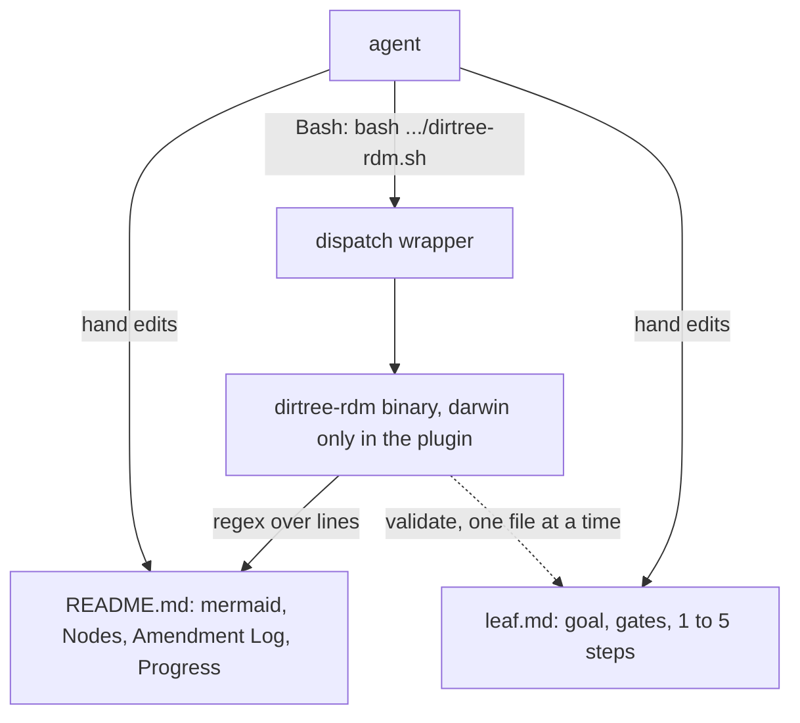
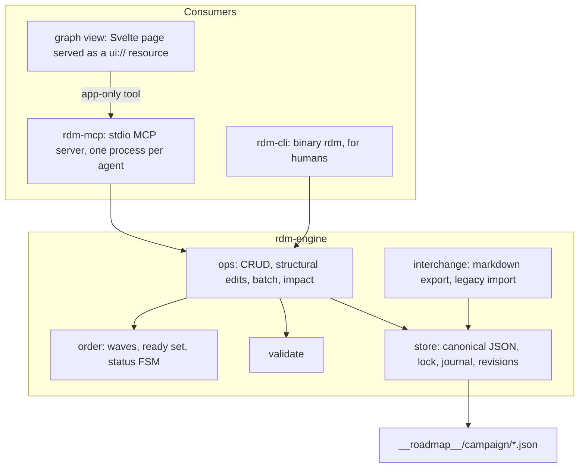
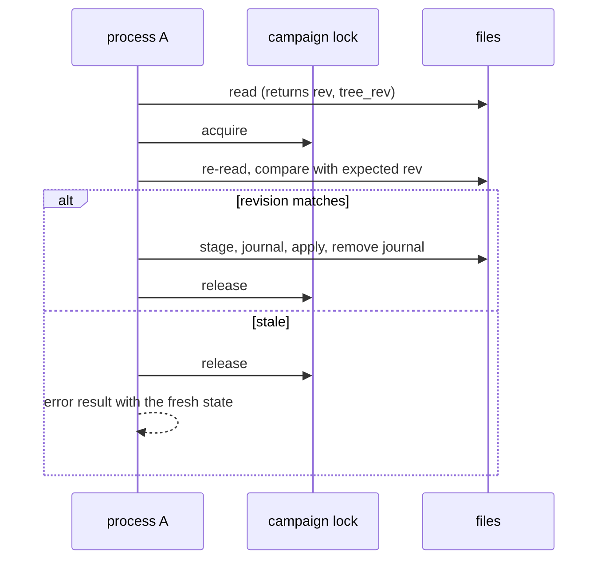
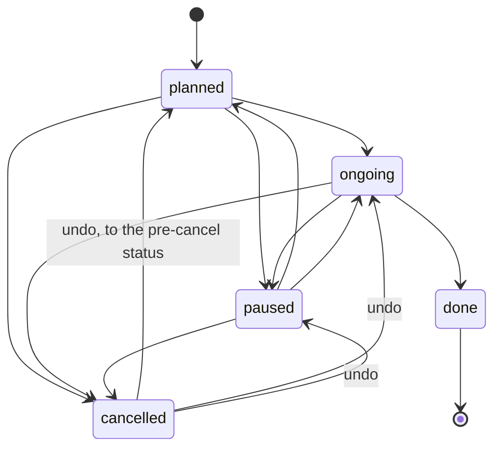

# rdm — Architecture

The design of `rdm`, the Rust core, MCP server and CLI that replace the `dirtree-rdm` script of the
`managing-roadmaps` skill. Nothing is built yet. Points marked *provisional* are expected to move
once code meets real hosts; points marked *suggestion* are left to the milestone that owns them; the
rest stand unless implementation proves them wrong, and then this document changes together with
the code. Decisions were taken with the maintainer on 2026-11-11. Amended on 2026-11-16 (A1 of the
meta-roadmap): the domain model and the stored types move to a fourth crate, `rdm-schema`, owned by a
spec-first milestone M0b. M0b settled it on 2026-11-16: status meanings in
[statuses.md](statuses.md), the stored schema in [stored-schema.md](stored-schema.md) with its
[traceability.md](traceability.md), and the read model in [read-model.md](read-model.md). Where
this document and those four differ, they win.

## Executive Summary

- **Problem.** `managing-roadmaps` drives long-horizon work through a shell-wrapped CLI over strict
  markdown. Unattended runs deny the shell call and the run breaks. The CLI covers only a small
  part of what a roadmap needs: no leaf editing, no batch, no amendment or progress writer, no
  graph walk. Re-planning a long roadmap is therefore hand-editing a grammar. The markdown itself
  serves a human review that no longer happens.
- **Proposed change.** One Rust library, `rdm-engine`, owns the roadmap model, its JSON store and
  every graph operation. Two thin consumers sit on it: `rdm-mcp`, a stdio MCP server for agents,
  and `rdm-cli` (binary `rdm`) for humans. JSON is the stored format; markdown is an export. The
  server carries a graph view for MCP Apps hosts. The stored types and the read model live in a fourth crate, `rdm-schema`, versioned on its own. All four crates are published to crates.io.
- **Non-goals.** Explicit dependency edges (depth stays the ordering); an HTTP transport; a UI that
  writes; scheduling or assignment of agents; anything about what a roadmap should contain.
- **Biggest risks.** Hosts that do not yet speak MCP 2026-07-28; rmcp's fast-moving 3.x API and its
  untyped MCP Apps support; lost or torn writes when many agent processes edit one campaign; a
  consumer that grows logic of its own; a launch that cannot follow plugin updates.
- **Validation.** A spike against real hosts before anything else (M0); a multi-process test with
  kill injection on three operating systems; property tests over random operation sequences;
  lossless import and export of this repository's eight existing campaigns; equal results from the
  CLI and the MCP tools on the same input.

## Current State



- The tool is `skills/managing-roadmaps/scripts/dirtree-rdm/`, a Rust crate of about 3,000 lines
  (`clap`, `regex`). Commands: `init`, `add`, `status`, `update` (status only), `move`, `insert`
  (wrap one node), `validate`, `ls`, `grammar`.
- A roadmap is a directory tree under `__roadmap__/<campaign>/`: a `README.md` per directory node
  and a `<name>.md` per leaf, both held to a BNF grammar.
- **Ordering is depth.** Siblings are parallel; a deeper level runs after every shallower leaf.
  There are no edges and no code that walks the tree.
- **What the tool does not do:** edit any leaf field; write the Amendment Log or the Progress
  table; check a status transition; compare the tables with the filesystem; validate a whole
  campaign; emit JSON; lock anything. `move` and `insert` change several files without a
  transaction.
- **Distribution:** the plugin commits two darwin binaries; Linux and Windows builds reach only the
  `.skill` release asset (`__reports__/dirtree_rdm_plugin_binaries/`).

## Proposed State



| Decision | Value |
|:--|:--|
| Graph model | Depth is ordering: siblings parallel, deeper level later. No explicit edges. |
| Stored format | JSON, one file per node, under `__roadmap__/<campaign>/`. Markdown is export only. |
| Transport | stdio only. Concurrency safety comes from the filesystem. |
| Mutations | Full CRUD, single or batch. Content and structure edits carry a mandatory amendment description and are logged. Status and progress go to a per-leaf history, with no description. |
| Protocol | MCP 2026-07-28 conformance only. `rmcp` pinned exactly (3.9.0 at design time, MSRV 1.88). |
| UI | MCP Apps (`io.modelcontextprotocol/ui`, spec 2026-01-26). Svelte 5, one inlined HTML file embedded in the server binary. Read-only in the first version. |
| Home | A Cargo workspace in this repository under `crates/`, outside `skills/`. |
| Crates | `rdm-schema` (stored types, read-model types, JSON Schemas, format version), `rdm-engine` (library), `rdm-mcp` (server), `rdm-cli` (binary `rdm`). |

**The consumer rule.** `rdm-mcp` and `rdm-cli` hold no roadmap logic. Each maps its inputs to one
core call and renders the result. A behaviour that exists in one consumer and not in the core is a
defect.

## Data Model

```
__roadmap__/<campaign>/
  _dir.json                 campaign root
  _amendments/<ulid>.json   one file per amendment, append-only
  _comments/<ulid>.json     one file per comment, append-only
  <leaf>.json               leaf node
  <dir>/_dir.json           directory node
  <dir>/<leaf>.json
  .rdm/                     untracked scratch: lock, journal/, staging/
```

- **Names are paths.** A node's name is its path segment (`^[a-z][a-z0-9_-]*$`) and is not stored
  in the file, so it cannot disagree with the filesystem. `_dir.json` cannot collide with a node.
- **Identity is separate.** Every node carries an immutable `id`. Tools accept a path or an id and
  return both. References between nodes hold ids, so they survive a rename or a move.
- **Stored:** node prose, leaf status, steps, progress, per-leaf status history.
- **Derived on every read, never stored:** directory status, the node table, the mermaid graph,
  the progress table, waves, the ready set. Derived data cannot go stale, and a status change
  never writes to an ancestor.
- **One file per leaf and per amendment** keeps task branches in separate worktrees from touching
  the same file, so merges do not conflict.
- **Canonical form:** fixed field order, two-space indent, LF, trailing newline. Multi-line prose is
  stored as an array of lines, which git merges far better than one escaped string; the API
  accepts and returns plain strings.
- **Forward compatibility:** every file carries `schema_version` (`"MAJOR.MINOR"`, first value `"0.1"`); unknown fields round-trip; a
  reader refuses a newer major version with an upgrade message. JSON Schemas are generated from
  the Rust types and committed; CI fails when they drift.

The stored types are settled in [stored-schema.md](stored-schema.md) and held by the
`rdm-schema` crate, whose JSON Schemas are generated and checked for drift. In outline:

```
_dir.json   { schema_version, id, kind: campaign|directory, title, context, goal, references[],
              preconditions[Criterion], success_gates[Criterion], gotchas, notes }
<leaf>.json { schema_version, id, kind: leaf, title, status, status_reason?, goal,
              preconditions[Criterion], success_gates[Criterion], references[], steps[1..5],
              progress{branch?, commits?, notes}, history[] }
step        { id, title, goal, implementation_logic, deliverables, references[],
              checks[{text, expected, command?}], commit{type, scope?, breaking, summary},
              requires?, done, commit_sha?, done_at? }
Criterion   { text, met }          Reference { label?, title, target?, note? }
history     { ts, from, to, actor{kind: agent|human|import, name?}, reason?, override?, op_id? }
comment     { schema_version, id, node_id, ts, actor, text }
amendment   { schema_version, id, legacy_id?, ts, actor, description, source?, op_id?,
              changes[{node_id, op, path_before?, path_after?, field?, old?, new?}], snapshot? }
```

Every legacy grammar production is stored, derived or dropped with a reason in
[traceability.md](traceability.md). The read model that every consumer receives (MCP outputs,
CLI `--json`, the view) is four projections in [read-model.md](read-model.md); each leaf there
reports its `level` together with `level_source: depth`.

The amendment log of a node is the set of amendment files whose `changes` name its id. A delete
stores the removed subtree in `snapshot`, so it can be restored.

## Concurrency

Each agent has its own server process, and a human may run the CLI at the same time. All of them
write the same files.



- **Lock:** one operating-system advisory lock per campaign (`.rdm/lock`), held only for the write
  window. The kernel releases it when a process dies, so there is no stale lock. A waiter retries
  for a few seconds, then returns a `LOCKED` error naming the holder.
- **Atomic single-file write:** temporary file in the same directory, fsync, rename.
- **Multi-file transaction:** stage the new contents, write a journal of idempotent steps, mark it
  committed, apply, remove it. The amendment file is part of the transaction. On the next lock
  acquisition a committed journal is rolled forward and an uncommitted one discarded.
- **Optimistic revisions:** a read returns a content hash per node (`rev`) and per campaign
  (`tree_rev`). A field edit presents `expected_rev`; a structural batch presents
  `expected_tree_rev`; a status move presents the status it expects to leave. A mismatch returns an
  error result with the current state. Nothing is merged automatically.
- **Retries:** a write may carry an `op_id`; replaying it returns the first result.
- **Worktrees are separate copies.** A lock in one worktree does not coordinate with another.
  Status written on a task branch reaches the coordinator when that branch merges. The coordinator
  records `ongoing` in its own tree when it dispatches a leaf.

## Graph operations

- **Load and validate** a whole campaign, returning diagnostics with a stable code, a severity, a
  path and a JSON pointer.
- **Order.** The wave of a leaf is its depth, shown as `level`. A leaf is ready when it is
  `planned` and every leaf that holds it back is `done` or `cancelled`. The rule is scoped
  (Eliott, 2026-11-16): an unfinished leaf holds back only the deeper leaves under its own
  parent, never a leaf in an unrelated branch. Waves are a display of depth, not a readiness
  fact. Details and examples in [statuses.md](statuses.md) §Ready set.
- **Status FSM.**



  The full table of moves, who may make them and their reasons is in [statuses.md](statuses.md).
  `done` is the only terminal status. Entering `paused` or `cancelled` needs a reason, and undoing
  a cancel restores the status before it. Pausing or cancelling a directory applies to every
  non-terminal leaf under it as one operation, and a directory cancel is undone through its
  `op_id`. `done` requires every step recorded done with its commit. Starting a leaf outside the
  ready set is refused unless an override with a reason is given, and the override is recorded.
  A directory's status is derived from its leaves. **Sealing:** a `done` node's content never
  changes, and a `cancelled` node's content is sealed while it is cancelled; both accept only
  appended comments. Every content edit to a `planned`, `ongoing` or `paused` node carries an
  amendment description.
- **Primitives:** add, remove (subtree), set field, rename, move to another parent.
- **Composites,** each expanding to primitives: wrap siblings in a new level, unwrap a level, split
  a leaf, merge leaves, promote a leaf to a directory, reorder steps, "run X after Y" (expressed as
  depth edits, with candidate plans ranked by nodes moved).
- **Impact analysis** on every structural edit: wave changes per node, leaves made ready by a cancel,
  progress destroyed, ongoing leaves moved. A destructive effect needs an explicit acknowledgement.
- **Batch:** an ordered list of operations, validated one by one and as a whole, applied
  atomically, with a dry-run. Later operations may refer to nodes created earlier in the batch.

## Tool surface (suggestion)

M4 decides the final list. Fixed: a small set in a deterministic order; every call names its
campaign path; the amendment rule; a text summary plus `structuredContent` with an `outputSchema`
on every tool; read tools marked read-only; no tool requires user interaction.

| Tool | Kind | Purpose |
|:--|:--|:--|
| `roadmap_list` | read | Campaigns under a root, with counts. |
| `roadmap_view` | read, carries the UI | Whole-campaign outline and waves. |
| `roadmap_get` | read | Nodes by path or id, with revisions. |
| `roadmap_next` | read | Ready leaves and what stalls the current wave. |
| `roadmap_validate` | read | Diagnostics for one campaign or all. |
| `roadmap_amendments` | read | The amendment log, filtered by node or date. |
| `roadmap_export` | read | Markdown of a leaf, a node or a campaign. |
| `roadmap_init` | write | Create a campaign, optionally from a nested tree. |
| `roadmap_update` | write | Edit one node's fields; amendment required. |
| `roadmap_transition` | write | Status moves, `done` included, and progress. |
| `roadmap_apply` | write | The batch of structural operations: every re-branching and move. |
| `roadmap_import` | write | Legacy markdown tree to JSON. |
| `ui_snapshot` | app-only | Compact data for the graph view. |

The CLI mirrors the same operations as verbs, with a `--json` output.

## Graph view

A Svelte 5 page, built to one HTML file with every script and style inlined, embedded in
`rdm-mcp` and served as a `ui://` resource with the MCP Apps MIME type. It shows waves as columns,
leaves coloured by status, directories as groups, a leaf detail pane and the amendment timeline.
It polls an app-only tool and writes nothing. The built file is committed, because crates.io
consumers have no Node; CI rebuilds it and fails on a difference. A host without Apps support
receives the same data as text and structured content.

## Key Flows

| Flow | Sequence |
|:--|:--|
| Author a campaign | `init` with a nested tree, then `validate`. |
| Execute | `next` → `transition` to `ongoing` → work → `transition` recording each step's commit → `transition` to `done`. |
| Edit a field | `get` (revision) → `update` with the new value and the amendment description. |
| Re-plan | `apply` with dry-run → read the impact report → `apply` with acknowledgements. |
| Read as a human | `rdm export <node>` or `roadmap_export`. |
| Migrate | `import` with dry-run → fix what the report names → `import`. |

## Contracts & Invariants

| # | Invariant |
|:--|:--|
| I1 | Depth is the only ordering. No stored field expresses a dependency between siblings. |
| I2 | A consumer holds no roadmap logic; the CLI and the MCP tools give the same result on the same input. |
| I3 | No write leaves a campaign in a state `validate` rejects, including after a crash at any point. |
| I4 | A write based on a stale revision is refused and changes nothing. |
| I5 | Every content or structure edit produces exactly one amendment with a non-empty description. Status, progress, criterion marks and comments never do. A sealed node accepts no content edit. |
| I6 | Derived data is never stored. |
| I7 | A node's `id` never changes; a rename or move changes only its path. |
| I8 | The move to `done` is allowed only when every step is done with its commit recorded; it is checked at that move. A stored `done` leaf has every step done (a leaf imported from legacy markdown has no commit SHA, and keeps its legacy count in `progress.commits`). |
| I9 | Deleting sealed work, or moving ongoing work, needs an explicit acknowledgement. Nothing reopens done work: new work is a new node. |
| I10 | The server keeps no state between calls; every call names its campaign. |
| I11 | No tool requires user interaction, and no read tool writes. |
| I12 | A reader never drops a field it does not know. |

## Launch and distribution (*provisional*, owned by M7)

- **Publication:** the four crates on crates.io, released by CI after a merge to `main`
  (`release-plz`; `rdm-schema` on its own version line, the other three on one product version; a format or
  read-model major forces an `rdm-schema` major and a minor a minor, as in [read-model.md](read-model.md) §Versions), beside the existing skill releases. In one workflow run:
  crates (schema, core, then server and CLI), then prebuilt binaries and checksums on the GitHub release, then the plugin pinned to
  that version. The plugin never names an unpublished server.
- **Launch:** the plugin runs `rdm-mcp serve --require-version X.Y.Z`. A binary of another version
  fetches the matching prebuilt one from the release, checks its sha256, caches it per version and
  runs it. A consumer installs once; later plugin updates bring their own server. When the download
  fails, an installed binary of the same major version runs with a warning; otherwise the server
  exits with the exact install command.

## Alternatives Considered

| Decision | Options | Chosen | Tradeoff accepted |
|:--|:--|:--|:--|
| Graph model | Explicit edges / hybrid / **depth** | depth | The tree over-sequences; "run X after Y" is a structural edit, with its impact reported |
| Transport | HTTP daemon / stdio + HTTP / **stdio** | stdio | Concurrency is the store's job; no host that needs a URL is served |
| File layout | One file per campaign / per directory / **per node** | per node | More files; no hot file, clean merges |
| Amendments | In each node / one log file / **one file per amendment** | per amendment | A node's log is a query, not a field |
| Revisions | Counter / **content hash** | hash | No base to merge from, so a conflict is refused, never merged |
| Lock | Lock file as existence / per file / **one OS lock per campaign** | per campaign | Writers on one campaign are serialised, for milliseconds |
| Amendment scope | Every write / **content and structure** | content and structure | Status history is kept apart from the amendment log |
| Mutation policy | Additive only / **full CRUD, with done and cancelled nodes sealed** | full CRUD | History lives in amendments, not in undeletable nodes |
| Consumers | MCP only / **MCP and CLI over one core** | both | A second surface to keep thin |
| UI | None / server-rendered image / **Svelte page as an MCP App** | Svelte | A Node build in CI and a committed artefact |
| Registry | PyPI wheels / npm / **crates.io** | crates.io | No pinned-run launcher, hence the self-provisioning launch |
| Protocol | Several revisions / **2026-07-28 only** | one | Older hosts are not served |

## Risks & Mitigations

| Risk | Mitigation |
|:--|:--|
| A host does not speak 2026-07-28 | M0 tests the real hosts first; the transport stays isolated in `rdm-mcp` |
| rmcp API churn, untyped Apps support, a wrong extension id in its documentation | Exact pin; M0 fixes the calls; one module owns the Apps metadata |
| Lost or torn writes under concurrency | Lock, journal, revisions; a multi-process test with kill injection on three operating systems |
| Directory renames fail on Windows while a handle is open | Retry with backoff; a Windows test job |
| A consumer grows logic | I2 as a test: the same input through both consumers |
| The graph view grows past a small bundle | Size budget in CI; a hand-written bridge if the Apps client library is heavy |
| A restructure silently reorders work | Impact analysis and acknowledgements (I9) |
| The launch cannot reach the release | Same-major fallback; a loud failure with the install command |
| The allow-rule string for a hyphenated plugin name is guessed wrong | Read from a real session in M0, never hard-coded from a guess |
| Legacy roadmaps import wrongly | The eight campaigns of this repository as golden fixtures, one of them invalid by design |

## Deliberately open

Decided by the milestone that owns it: the id minting and the journal format (M1); the
exact operation set and its error codes (M2); whether a cross-worktree claim hint is worth having
(M2); markdown layout of the export and what the importer does with invalid input (M3); tool names,
count and output budgets (M4); CLI verbs and output style (M5); layout and refresh of the view
(M6); the launch, the release order and binary targets (M7); what the skill says and which
references survive (M8).

## Implementation

The milestones, their order, exit gates and scope are in the meta-roadmap
[`__roadmap__/roadmap-mcp-rework/`](../../__roadmap__/roadmap-mcp-rework/README.md). Each milestone
is planned in detail by its own session, as its own campaign under `__roadmap__/`.
