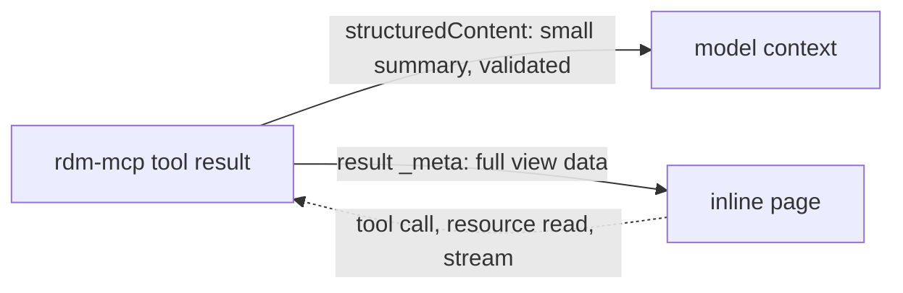

# M0 feasibility spike: Findings (v0)

Date: 2026-11-16

---
type: findings
topic: m0-feasibility-spike
date: 2026-11-16
version: v0
prior-version: none
key-metric: data-to-paint (Desktop, 160 nodes, 438,707 B): 18 ms (prior: N/A, delta: N/A)
decision-required: confirm
---

## Headline Result

metric: hosts where the stack works as designed
value: 0 of 3 as designed; 3 of 3 with a changed data path
unit: hosts
prior: N/A (first run)
direction: new

Source: [desktop.md](trials/desktop.md), [vscode.md](trials/vscode.md), [cli.md](trials/cli.md). The pinned stack (rmcp =3.10.0, MCP 2026-07-28, Apps 2026-01-26) connects on all three hosts. Desktop cannot take page-to-server calls, so R01's "page polls an app-only tool" holds only on VS Code.

## Results Tables

### Gate table (gates of `__roadmap__/roadmap-mcp-rework/m0_feasibility_spike.md`)

| # | Gate | Verdict | Evidence |
|:--|:--|:--|:--|
| 1 | Stub lists and calls its tool in Desktop, VS Code, CLI | PASS | Desktop: tool listed, called, page renders [desktop.md, Trial 1]. VS Code: connected and called [vscode.md, header]. CLI: `roadmap_view` found and called, `node_count` 16 [cli.md] |
| 2a | Page renders in Desktop and VS Code | PASS | Desktop 16 of 16 nodes and 160 of 160 from `_meta` [desktop.md, Trial 4]. VS Code 16 of 16 [vscode.md, Trial 1] |
| 2b | Leaf content through an app-only tool | DEVIATION | Desktop: BLOCKED, `IPC not available for MCP tool call`, no `serverTools` [desktop.md, Trial 1, Trial 2]. Leaf content reaches the page through the result `_meta` instead [desktop.md, Trial 4]. VS Code: PASS, `serverTools` advertised, no tool errors [vscode.md, Trial 1, Trial 2] |
| 2c | Full view | DEVIATION | Desktop offers `inline` and `fullscreen` [desktop.md, Trial 2]. The notes do not record that fullscreen was opened. VS Code offers `inline` only and fell back to the inline outline [vscode.md, Trial 1, Trial 2] |
| 2d | Zero network requests | PASS | `check:offline` passes for the built page (coordinator brief; the command output is not in a trial note). The only request is the deliberate localhost stream test [vscode.md, Trial 2; desktop.md, Trial 3: CSP-blocked] |
| 3 | Host dumps as raw JSON, protocol versions | DEVIATION | Capabilities and context are summarised per host [desktop.md, Trial 2; vscode.md, Trial 1]. Desktop's raw dump `desktop-host.json` is referenced but is not in the committed trial folder. No raw JSON for VS Code or CLI. Versions: PASS (see Protocol table) |
| 4 | Time to display, cold and warm, median and worst | DEVIATION | Single samples, no series. See Timing |
| 5 | Allow-rule string from a real session | PASS | Both forms read from `claude -p` 2.1.316 [allow-rule.md]. Desktop agrees for the project form [desktop.md, Trial 2] |
| 6 | Crate names free | DEVIATION | `rdm-core` was taken; Eliott chose `rdm-engine` on 2026-11-16 [milestone gate text; R01 commit af8ad04]. The availability check of the other three names is not in a trial note |
| 7 | Go or no-go per host | PASS | Next table |

### Go or no-go per host

| Host | Verdict | Reason |
|:--|:--|:--|
| Claude Code Desktop (5.11492.5) | **GO, inline and one-shot** | The page renders, and all view data can ride in the result `_meta`: 438,707 B painted 18 ms after arrival and cost the model 203 characters [desktop.md, Trial 4]. No tool call, resource read or stream works from the page [desktop.md, Trial 1, Trial 3] |
| VS Code Copilot | **GO, every channel** | `serverTools`, `serverResources` and the localhost stream all work; 4,391,237 B and 1,600 nodes paint first at 64 to 70 ms [vscode.md, Trial 2]. No fullscreen and no `ui/message` [vscode.md, Trial 1] |
| Claude Code CLI (2.1.316) | **GO for the tools** | Tool listed and called without a prompt under the allow rule [cli.md]. It renders no Apps [cli.md] |

### Protocol versions

| Host | MCP | Apps (view announced / host returned) | Evidence |
|:--|:--|:--|:--|
| Desktop | 2026-07-28 | 2026-01-26 / 2026-01-26 | Server refuses any other MCP version, and the host connected [desktop.md, header, Trial 2] |
| VS Code | 2026-07-28 | 2026-01-26 / 2026-01-26 | [vscode.md, header, Trial 1]. The earlier negotiation issue no longer applies |
| CLI | 2026-07-28 | not applicable | [cli.md] |

### Host capabilities that decide the design

| Capability | Desktop | VS Code | Source |
|:--|:--|:--|:--|
| `serverTools` | absent | present, `listChanged` | desktop.md T2; vscode.md T1 |
| `serverResources` | advertised, but every read failed `read_failed` | present, 65 reads worked | desktop.md T3; vscode.md T2 |
| Localhost stream (declared in `_meta.ui.csp.connectDomains`) | CSP-blocked in Trial 3. The Trial 4 capability list shows the domain; stream not re-tested | worked (SSE, 4,391,237 B) | desktop.md T3, T4; vscode.md T2 |
| `message` / `ui/message` | `message {text}` advertised; call returns ok, no `RDM_PROBE` in the transcript | not advertised | desktop.md T2, T4; vscode.md T1 |
| `availableDisplayModes` | `inline`, `fullscreen` | `inline` | desktop.md T2; vscode.md T1 |
| `updateModelContext` | `{text, image}`, returns ok, nothing in the transcript | `{image, audio, resource, resourceLink, structuredContent}`, ok | desktop.md T2; vscode.md T1 |

### Model context versus page (Desktop)

| Item | Seen by model | Delivered to page | Source |
|:--|:--|:--|:--|
| `structuredContent` | yes, contrary to the Apps spec; validated against `outputSchema` | yes | desktop.md T4 |
| Result `_meta`, scale 1 | no; 200 characters seen | 43,715 B, 16 of 16 nodes | desktop.md T4 |
| Result `_meta`, scale 10 | no; 203 characters seen | 438,707 B (about 439 KB), 160 of 160 nodes | desktop.md T4 |
| `result` channel, scale 1 | yes, 45,034 chars (about 11k tokens) | yes | desktop.md T3 |

### Allow-rule string (CLI 2.1.316)

| How the server loads | Rule string | Source |
|:--|:--|:--|
| Project `.mcp.json`, server `rdm` | `mcp__rdm__roadmap_view` | allow-rule.md |
| Plugin `managing-roadmaps`, server `rdm` | `mcp__plugin_managing-roadmaps_rdm__roadmap_view` | allow-rule.md |

The hyphen of the plugin name is kept. **Trap:** a project server with the same name `rdm` wins, and the plugin name never appears. The first plugin check showed the project form for that reason [allow-rule.md].

### Other facts

| Item | Value | Source |
|:--|:--|:--|
| Built page size | 279 to 286 KB, about 234 KB of it ext-apps with zod. The leaf's own limit was 250 KB [graph_view.md, Step 1 item 2] | coordinator brief; not in a trial note |
| macOS install trap | A binary overwritten in place is killed at start with SIGKILL (exit 137); the host reports "Couldn't reconnect rdm: Connection closed". Fix: `rm` then `cp`, a new inode | desktop.md T2 |
| Desktop user agent | `Claude/5.11492.5`, Electron 45.2.1, Chrome 156 | desktop.md header |

## Timing

Trial notes: [desktop.md](trials/desktop.md), [vscode.md](trials/vscode.md). Every figure is one sample, from the run named in its row. There are no medians and no confidence intervals.

> **DEVIATION from the leaf.** The leaf asked for `timing.py` over a `probe.jsonl`, with a 20-run cold and warm series and bootstrap CIs. Neither exists.
> - Claude Code Desktop does not let the page call the server ([desktop.md](trials/desktop.md), Trial 1: `IPC not available for MCP tool call`). No stamp could be recorded server-side. Probes were read off an on-screen panel.
> - At Eliott's steer, the spike measured data channels and payload sizes instead of a repeated series.
> - The single samples still answer the question. The number that matters is data-to-paint, and it is tens of ms in every run. The large figures are host-side delays that follow user attention: Desktop creates the page frame only when the message is on screen ([desktop.md](trials/desktop.md), Trial 4 scale 10: 670,660 ms, Eliott scrolled back after about 11 minutes). No repetition would shrink a delay that depends on the reader. No `timing.py` was written.

### Data to paint, per host and channel (one sample each)

| Host | Channel | Payload [source] | Data reached page | First paint | Complete |
|:--|:--|:--|:--|:--|:--|
| Desktop | `_meta`, scale 1 | 43,715 B, 16 nodes [desktop.md, Trial 4] | 318 ms after server stamp | 371 ms | 372 ms |
| Desktop | `_meta`, scale 10 | 438,707 B, 160 nodes [desktop.md, Trial 4 scale 10] | 18 ms from data to first paint | same as data | same as first paint |
| VS Code | `result` x1 | 43,715 B, 16 nodes [vscode.md, Trial 2] | 24 ms | 41 ms | 41 ms |
| VS Code | `chunks` x100 | 4,391,237 B, 1,600 nodes, 65 `resources/read` [vscode.md, Trial 2] | 39 ms | 64 ms | 597 ms |
| VS Code | `stream` x100 (SSE) | 4,391,237 B, 1,600 nodes [vscode.md, Trial 2] | 28 ms | 70 ms | 157 ms |
| VS Code | `_meta` x1 | 43,715 B, 16 nodes [vscode.md, Trial 2] | 23 ms | 39 ms | 40 ms |

The Desktop scale-1 and scale-10 rows are not on the same clock. Scale 1 is server stamp to paint. Scale 10 is data arrival to first paint, because the server-to-page leg was lost to the user's delay (see next table).

### Host-side delays that are not display time (one sample each)

| Host | Run | Delay | Cause [source] |
|:--|:--|:--|:--|
| Desktop | `result` scale 1, Trial 2 | 46,970 ms | Eliott's copy delay. The panel showed the latest probe stamp, not first paint. Eliott saw the page paint at once [desktop.md, Trial 2] |
| Desktop | `_meta` scale 10, Trial 4 | 670,660 ms | Frame created when the message was on screen; Eliott scrolled back after about 11 min [desktop.md, Trial 4] |
| VS Code | `result` scale 1, Trial 1 | 73,679 ms | Unexplained: chat turn, trust prompt or off-screen page. Did not recur; later results arrived in 18 to 24 ms [vscode.md, Trial 1, Trial 2] |
| Desktop | `result` scale 1, Trial 3 | 2.3 s | Tool round trip, call to result in the transcript [desktop.md, Trial 3] |

### Why one sample is enough here

| Question | Answer from the data |
|:--|:--|
| Is display slow at the sizes M6 needs? | No. 438,707 B paints 18 ms after arrival on Desktop; 4,391,237 B starts painting at 64 to 70 ms on VS Code |
| Does noise hide a difference that matters? | The spread between the fast runs is tens of ms. The delays that look large are one to three orders of magnitude bigger and come from attention, not from the host or the page |
| What would a series add? | Tighter CIs on tens of ms. It would not change a go or no-go |

## Observations

| Signal | Baseline / Expected | Observed [source] | Interpretation |
|:--|:--|:--|:--|
| Page-to-server calls | R01: the page polls an app-only tool | Desktop declines: no `serverTools`, `IPC not available` [desktop.md T1, T2] | Polling cannot be the only update path. It works on VS Code only |
| `structuredContent` and the model | Apps spec: not added to model context | In Desktop it is, in full, and it is schema-validated [desktop.md T4] | Keep `structuredContent` a small, valid summary |
| Result `_meta` | Reaches the page and the model, if at all | Page only. 439 KB to the page, 203 characters to the model [desktop.md T4] | `_meta` is the free channel for view data on Desktop |
| `serverResources` on Desktop | Advertised means usable | `read_failed` for every URI [desktop.md T3] | The advertised list cannot be trusted. Test each channel |
| Declared CSP domain | Host honours `connectDomains` | Desktop blocked it, VS Code adopted it [desktop.md T3; vscode.md T1] | Streaming is a VS Code feature only |
| Display time | A figure to budget | Tens of ms from data to paint [Timing] | Display is not the bottleneck. Payload size and model cost are |
| Bundle | 250 KB limit of the leaf | 279 to 286 KB (coordinator brief) | Over the limit by 29 to 36 KB. ext-apps with zod is about 82% of it |
| Install | `cp` over the old binary works | Killed with SIGKILL on macOS [desktop.md T2] | The installer must write to a new inode |

## Charts & Visualizations

Caption: on Desktop the solid arrows work and the dashed arrow fails (no `serverTools`, `read_failed`, CSP). On VS Code the dashed arrow works too.

## Proposed amendments (not applied)

| Leaf | Proposal | Evidence |
|:--|:--|:--|
| M4 | View data goes in the result `_meta`. `structuredContent` stays a minimal summary that is valid against `outputSchema` in every mode | desktop.md T4 |
| M6 | A choice for Eliott, two designs below | below |
| M7 | Pin both allow-rule strings. Install binaries by `rm` then `cp` so each install has a new inode. Size the launcher cache with that in mind | allow-rule.md; desktop.md T2 |
| R01 §Graph view | "It polls an app-only tool" is invalidated for Desktop. Propose: "It is fed once from the result `_meta`. It polls an app-only tool or streams only where the host advertises `serverTools` or the stream domain". Not edited here: §Graph view is M0b's | desktop.md T1, T2; vscode.md T1 |

### M6 design choice (Eliott decides)

| | (a) Inline view fed once from `_meta`, progressive only where supported | (b) Standalone viewer: Svelte in Tauri or a local page driven by `rdm`, over IPC or RPC to the Rust core |
|:--|:--|:--|
| Evidence for | 438,707 B paints 18 ms after arrival on Desktop at no model cost [desktop.md T4]. VS Code streams 1,600 nodes with first paint at 64 to 70 ms [vscode.md T2] | Desktop inline has no tool call, resource read or stream [desktop.md T1, T3], so large or live views cannot refresh there. A standalone viewer has none of these limits [desktop.md, What this means] |
| Cost | Live refresh and leaf-on-demand only on VS Code. Bundle is over 250 KB | A second shell to ship and launch (M7) |
| Fits | Snapshot of the roadmap in the chat | Large and live views |

## Contradictions & Surprises

- `serverResources` is advertised on Desktop, yet every read failed [desktop.md T3].
- `structuredContent` enters the model context in Claude Code, against the Apps spec [desktop.md T4].
- The 2026-07-28 negotiation issue known for VS Code did not occur [vscode.md header].
- The built page is over its own size limit [coordinator brief].

## Steering Questions

- [now] M6: design (a), inline from `_meta`, or (b), standalone viewer, or (a) first and (b) later?
- [now] Accept the single-sample timing as the answer to the timing gate, or ask for a series?
- [next run] Re-test the Desktop stream, since the capability list now shows the domain, and exercise Desktop fullscreen, which the notes do not record?
- [later] Accept the bundle at 279 to 286 KB, or write a hand-made bridge to cut the 234 KB of ext-apps with zod?

## Pointers

- [trials/desktop.md](trials/desktop.md)
- [trials/vscode.md](trials/vscode.md)
- [trials/cli.md](trials/cli.md)
- [trials/allow-rule.md](trials/allow-rule.md)
- [README.md](README.md)
- `__design__/rdm/architecture.md`
- `__roadmap__/roadmap-mcp-rework/m0_feasibility_spike.md`
