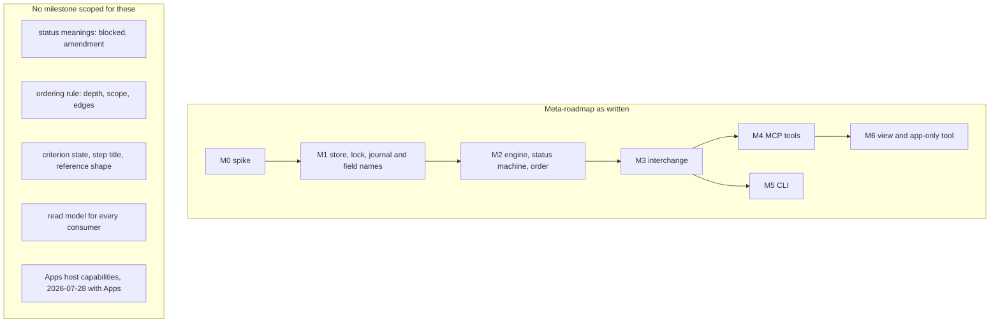

# rdm domain model review — Observation (v0)

Date: 2026-11-16

---
type: observation
topic: rdm_domain_model_review
spotted-during: Brainstorming the ui:// resources (MCP Apps views) for the managing-roadmaps plugin redesign
date: 2026-11-16
domain: code
confidence: confirmed
urgency: high
deferred-because: The originating session is a UI brainstorm, and R01 and the meta-roadmap belong to the redesign session on branch claude/managing-roadmaps-redesign-5fcb9f
---

## What Was Noticed

- R01's data model is marked provisional and handed to M1, but M1 is scoped as store, lock and journal. No milestone is scoped as the domain model: status meanings, the ordering rule, the stored schema inventory and the read model that consumers need.
- R01's schema sketch drops information the legacy BNF grammars carry: per-criterion state, step title, the breaking-change mark of a commit, and a structured reference shape.
- Status semantics are unspecified or changed without a recorded decision: `blocked` (who sets it, whether it holds back deeper levels, whether it can be undone) and `amendment` (the skill: initial status of a newly added node; R01: a `done` leaf that was edited).
- The ordering rule changed from parent-scoped (skill) to global (R01), and the meta-roadmap itself needs exact dependencies that depth cannot express (M6 waits on M5 for no reason; the exact edges live in reminders).
- M0's gates do not probe the MCP Apps surface that the views depend on, nor Apps on a 2026-07-28 server. M0 also tests a data model that is not settled, so it is only partly meaningful as written.

## Context

The UI sketches (an inline levels outline, a since-last-check-in digest, an amendments list, a levels carousel, leaf detail, a steps-across-leaves grid) were made only to brainstorm. They are explorations with invented data and record no decision. Tracing each element back to a field showed that the schema, not the UI, is what is unsettled.

Positions stated by Eliott in the originating session. None of them is a decision of record.

| Topic | Position stated |
|:--|:--|
| Priority | A clean core first. The MCP server, a UI and the CLI are all consumers of it. |
| Schema | A stable `rdm` schema crate, versioned on its own, so the schema and its consumers bump separately. |
| Ordering | Depth-only order is weak but works rather well, and applying things per depth is a property of topological layering. The question is a real discussion and is open. |
| M0 spike | Probably not doable as written on a lacking data model. A reduced spike could only check that Svelte paints a graph of existing depth-encoded roadmaps, that a full view and a leaf's content open, that Claude Code and maybe VS Code Copilot display it, and how long display takes. State tracking is out. |
| Roadmap | Whether the planned roadmap is sound, or a new one should be written, is to be assessed. |

Where the open items sit against the meta-roadmap:

## Location Map

- `/Users/hacker/Documents/tmp/claude-worktrees/cracking-shells-playbook/writing-release-rework-bff076/__design__/rdm/architecture.md` — R01 (branch `claude/managing-roadmaps-redesign-5fcb9f`, commit `b3b5bb0`): §Data Model, §Graph operations, §Tool surface, §Graph view, §Deliberately open
- `/Users/hacker/Documents/tmp/claude-worktrees/cracking-shells-playbook/writing-release-rework-bff076/__roadmap__/roadmap-mcp-rework/README.md` — meta-roadmap, Gotchas (ownership of shared pieces, the M6/M5 over-sequencing)
- `.../roadmap-mcp-rework/m0_feasibility_spike.md`, `.../core/m1_core_foundation.md`, `.../core/engine/m2_graph_engine.md` — gates and step 1 decisions of M0 to M2
- `skills/managing-roadmaps/scripts/dirtree-rdm/grammar/leaf.bnf` and `readme.bnf` — legacy accepted structure
- `skills/managing-roadmaps/references/graph-model.md` — §Edge Semantics (lines 52-59), §Status State Machine (61-80), §Amendment Algebra
- `skills/managing-roadmaps/SKILL.md` — "Depth Is Ordering" (lines 45-64)
- `modelcontextprotocol/modelcontextprotocol`, `docs/specification/2026-07-28/changelog.mdx` — items on the removed handshake, `ping`, and server-initiated requests; Deprecated item 1
- `modelcontextprotocol/ext-apps`, `specification/2026-01-26/apps.mdx` and `specification/draft/apps.mdx` — the `ui/*` messages, host capabilities and host context
- The UI explorations (private artifact): https://claude.ai/artifact/SJ15C4PxNjXWrKKbWuVwn5

## Evidence

### Legacy grammar against R01's schema sketch

| Item | Legacy (BNF) | R01 sketch | Effect |
|:--|:--|:--|:--|
| Entry criteria and gates state | `[x]` checkbox; ✅ or ⬜ | none | State is lost |
| Step title | `## Step N: title` | none | A step has no label for a stepper |
| Commit | `type(scope)!?: summary` | `{type, scope, summary}` | The `!` is dropped |
| Deliverables | one line of prose | `deliverables[]` | Import must split prose |
| Checks | one per step, text ending `(expected: PASS or FAIL)` | `checks[{command, expected}]` | Import must parse |
| References | one line in a leaf; `R\d{2} title, link, description` in a directory | `references[]`, shape not given | No structured shape |
| Leaf status | in the parent's Nodes table and Mermaid block | in the leaf; directories derived | Improved |
| Step progress | a commit count per node (Progress table) | `done` and `commit_sha` per step | Better, but no timestamp |
| Amendment | `A\d+`, day date, nodes added only | ULID, timestamp, operation list | Richer, readable id lost |

### Ownership of open items in the meta-roadmap

| Open item | Where R01 or the milestones put it | Gap |
|:--|:--|:--|
| Field names, id format | M1 (R01: provisional) | Folded into a store and concurrency milestone |
| Status transitions, directory status | M2 | Semantics of `blocked` and `amendment` not stated |
| Read model for consumers | not named | M2 owns order, M4 tool output, M6 the app-only tool |
| Apps host capabilities | M0 gates cover rendering and the allow-rule only | Not probed |
| Release versioning | R01: `release-plz`, a shared version across three crates | Conflicts with an independently versioned schema crate |

### Protocol facts that touch the views

| Fact | Source |
|:--|:--|
| 2026-07-28 core removes the `initialize` handshake, `ping` and `logging/setLevel` | changelog items 2 and 5 |
| 2026-07-28 core deprecates Sampling, Logging and Roots, and replaces server-initiated requests with multi-round-trip requests | changelog item 7, Deprecated item 1 |
| The Apps extension has its own dated spec, 2026-01-26, and a draft; it has no 2026-07-28 revision, and its draft examples show `protocolVersion` 2025-06-18 | `apps.mdx` |
| Views can call `ui/message`, `ui/update-model-context`, `ui/request-display-mode`, `ui/open-link` and `ui/download-file` (draft only), subject to host capabilities | `apps.mdx` |
| VS Code supports MCP Apps; the ext-apps repo ships a reference host, `basic-host` | ext-apps README |

## Re-observation Steps

1. Read R01 §Data Model and compare each field with `leaf.bnf` and `readme.bnf`.
2. Read the "Deliberately open" paragraph of R01 and match each item to a milestone leaf's step 1.
3. Read the meta-roadmap Gotchas for the M6 and M5 remark.

## Hand-off Questions

Working theory, if any: amend the existing meta-roadmap with a spec-first milestone before M1 rather than write a new one, because the skeleton (spike, core before consumers, parallel consumers, distribution, cutover) is intact. This is a working theory, not a decision.

- Where does the domain-model and schema work sit in the meta-roadmap, and what is left for M1 once it is out?
- Which crate holds the stored schema and which the read model, and how does the crate version relate to the `schema_version` written in files?
- Does the release policy move from one shared version to independent versions, and in what publish order?
- What do `blocked` and `amendment` mean as statuses, and who may set them?
- What is the reduced M0, which measurements does it record, and is it independent of the schema?
- Per-criterion state, step title, step timestamp, breaking mark, reference shape: which are in the stored schema?

## Scope Boundary

This report does not authorize the receiving agent to edit R01, the meta-roadmap or any reminder, or to start any milestone; those changes go through the redesign session and Eliott's approval.
