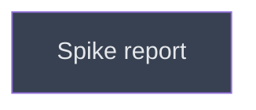

# Spike report

## Context
Depth 3 of the spike, its last level. It turns the trial data into the findings report, gives the go or no-go per host, and lands the R01 changes that M0 owns.

## Goal
A findings report under `__reports__/m0-feasibility-spike/` that later milestones can rely on.

## Pre-conditions
- [ ] `../host_trials.md` is done

## Success Gates
- ⬜ The report states a go or no-go per host, the timing per host and the allow-rule string, and each M0 gate with its verdict

## Gotchas
- **What R01 changes M0 owns:** the M0 merge edits R01 only in §Proposed State (the rmcp pin and the Apps calls) and in §Risks & Mitigations. M0b owns §Data Model, §Graph operations, §Contracts & Invariants, §Deliberately open and the launch section.

## Status

## Nodes
| Node | Type | Status |
|:-----|:-----|:-------|
| `spike_report.md` | 📄 Leaf Task | ⬜ Planned |

## Amendment Log
| ID | Date | Source | Nodes Added | Rationale |
|:---|:-----|:-------|:------------|:----------|

## Progress
| Node | Branch | Commits | Notes |
|:-----|:-------|:--------|:------|
