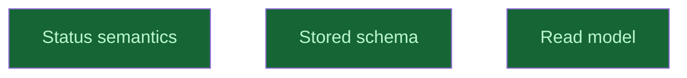

# M0b Domain model spec

## Context
Milestone M0b of the rdm meta-roadmap (`__roadmap__/roadmap-mcp-rework/m0b_domain_model_spec.md`), added by amendment A1 and run in parallel with M0. It settles what every stored fact means and what shape every consumer receives, before M1 builds the store on it. Its output is three spec documents under `__design__/rdm/`, the `rdm-schema` crate, and R01 brought in line.

## Reference Documents
- [R01 Architecture](../../__design__/rdm/architecture.md) — §Data Model, §Graph operations and §Contracts & Invariants: the provisional sketch this milestone settles
- [R02 Domain model gap analysis](../../__reports__/rdm_domain_model_review/01-gap_analysis_v0.md) — why the milestone exists and what it owns
- [R03 Domain model observation](../../__reports__/rdm_domain_model_review/00-observation_v0.md) — the legacy grammar compared with R01's sketch
- [R04 Ordering open question](../../__reports__/rdm_domain_model_review/00-open_question_v0.md) — the options kept open; depth stays the rule for now
- [R05 Legacy grammars](../../skills/managing-roadmaps/scripts/dirtree-rdm/grammar/) — `leaf.bnf` and `readme.bnf`, the productions the traceability table must cover

## Goal
The status meanings, the stored schema with its traceability table, and the read model are written down and held as types in `rdm-schema`. Each JSON Schema is generated from those types and checked for drift.

## Pre-conditions
- [x] Plan approved by Eliott (2026-11-16)
- [ ] The workspace skeleton (`__roadmap__/m0-feasibility-spike/workspace_skeleton.md`) is on the shared base before `feat/m0b-domain-model-spec` is cut

## Success Gates
- ⬜ `cargo test -p rdm-schema` passes on `feat/m0b-domain-model-spec`, including the schema drift test
- ⬜ `uv run --no-project tools/check_rdm_traceability.py` passes: every production of `leaf.bnf` and `readme.bnf` has a disposition
- ⬜ Eliott has reviewed `__design__/rdm/statuses.md`, `stored-schema.md` and `read-model.md`
- ⬜ R01 matches the three spec documents in the same merge

## Gotchas
- **Decisions already taken (Eliott, 2026-11-16):**
  - **Statuses:** the vocabulary is `planned / ongoing / paused / cancelled / done`.
    - `cancelled` stops a leaf or a whole subtree or feature, and holds nothing back.
    - `paused` is a pause that can be resumed, for a bug or to hold a leaf or a downstream branch.
    - `blocked` and `amendment` stop being statuses.
  - **Editing:**
    - A `done` node is sealed: only an append-only comment may be added.
    - Any content edit to a `planned`, `ongoing` or `paused` node carries the amendment note. The stricter rule applies uniformly.
    - Nothing reopens done work, so new work is a new node.
  - **Ordering:** depth stays the only ordering rule, so the schema has no edge field.
  - **Crate name:** the core crate is `rdm-engine`.
- **Open for Eliott in `status_semantics.md`:** whether `paused` holds back every deeper leaf (R01's global rule) or only those in its parent's subtree (the legacy rule). He noted that a halted upper leaf need not block everything downstream.
- **Who builds what (budget: shared USD 30 with M0):**
  - One Sonnet agent writes both depth-0 leaves, one after the other, on one task branch.
  - A second agent writes `read_model` and is then resumed for `rdm_schema_crate`.
  - The coordinator does `r01_sync`.
  - One adversarial verifier attacks the traceability table and the crate together, looking for silently dropped facts, a drift test that cannot fail, and unknown fields lost in a round trip.
- **What `rdm-schema` holds:** types, version constants and generated schemas. It has no I/O and no store. Canonical serialisation and the store belong to M1.
- **The crate's version:** it is published at M7 and stays at `0.x` until then.
- **The root `Cargo.toml` is fixed by the shared skeleton.** This milestone adds `crates/rdm-schema` and never edits the root manifest.

## Status

## Nodes
| Node | Type | Status |
|:-----|:-----|:-------|
| `status_semantics.md` | 📄 Leaf Task | ✅ Done |
| `stored_schema.md` | 📄 Leaf Task | ✅ Done |
| `read/` | 📁 Directory | ✅ Done |

## Amendment Log
| ID | Date | Source | Nodes Added | Rationale |
|:---|:-----|:-------|:------------|:----------|

## Progress
| Node | Branch | Commits | Notes |
|:-----|:-------|:--------|:------|
