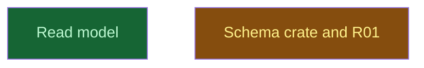

# Read model

## Context
Depth 1 of M0b. It runs after the status meanings and the stored schema have been reviewed by Eliott. The read model is what every consumer receives: MCP tool outputs, the CLI's `--json` output and the graph view.

## Goal
The read model's projections are specified with worked examples, and the crate and R01 follow from them.

## Pre-conditions
- [ ] `../status_semantics.md` and `../stored_schema.md` are done and reviewed by Eliott

## Success Gates
- ⬜ `read-model.md` has one worked example per projection, cut from the real meta-roadmap

## Gotchas
- `level` is reported together with its source (`depth`), so a later ordering rule can change the source without changing the shape.

## Status

## Nodes
| Node | Type | Status |
|:-----|:-----|:-------|
| `read_model.md` | 📄 Leaf Task | ✅ Done |
| `crate/` | 📁 Directory | 🔄 In Progress |

## Amendment Log
| ID | Date | Source | Nodes Added | Rationale |
|:---|:-----|:-------|:------------|:----------|

## Progress
| Node | Branch | Commits | Notes |
|:-----|:-------|:--------|:------|
