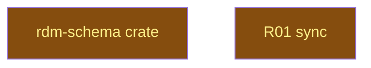

# Schema crate and R01

## Context
Depth 2 of M0b, its last level. The crate turns the three spec documents into types and generated schemas, and R01 is brought in line with them. The two leaves touch disjoint files and run in parallel.

## Goal
`rdm-schema` holds the whole domain model as types, and R01 describes it.

## Pre-conditions
- [ ] `../read_model.md` is done and reviewed by Eliott

## Success Gates
- ⬜ `cargo test -p rdm-schema` passes, and the adversarial verifier's findings are resolved or recorded

## Gotchas
- **What the verifier attacks:** the traceability table and the crate together. It looks for facts dropped silently, legacy data with no home, a drift test that cannot fail, types that differ from the spec documents, and unknown fields that a round trip loses.

## Status

## Nodes
| Node | Type | Status |
|:-----|:-----|:-------|
| `rdm_schema_crate.md` | 📄 Leaf Task | 🔄 In Progress |
| `r01_sync.md` | 📄 Leaf Task | 🔄 In Progress |

## Amendment Log
| ID | Date | Source | Nodes Added | Rationale |
|:---|:-----|:-------|:------------|:----------|

## Progress
| Node | Branch | Commits | Notes |
|:-----|:-------|:--------|:------|
