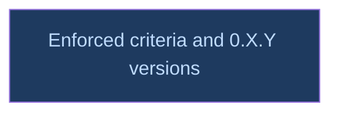

# Review amendment

## Context
Eliott's review, 2026-11-16, of the M0b domain-model specs reverses two rules: criteria are enforced, and versions are three-part. It amends the finished `rdm-schema` crate and R01 levels.

## Goal
Enforced criteria with trace records, and `0.X.Y` versions, in the specs, the crate and R01.

## Pre-conditions
- [ ] `../rdm_schema_crate.md` and `../r01_sync.md` are done

## Success Gates
- ⬜ `cargo test -p rdm-schema --locked` and the traceability checker pass, and no spec sentence says `met` gates nothing

## Status

## Nodes
| Node | Type | Status |
|:-----|:-----|:-------|
| `criteria_and_versions.md` | 📄 Leaf Task | 🔵 Amendment |

## Amendment Log
| ID | Date | Source | Nodes Added | Rationale |
|:---|:-----|:-------|:------------|:----------|

## Progress
| Node | Branch | Commits | Notes |
|:-----|:-------|:--------|:------|
