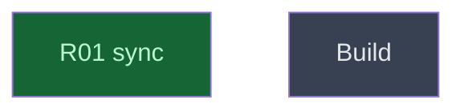

# Settle

## Context
Depth 1 of M1. It runs after both design documents are written and reviewed by Eliott, and brings R01 in line before any code is built on the new design.

## Goal
R01 and `read-model.md` describe the design of `store.md` and `contracts.md`.

## Pre-conditions
- [ ] `../store_design.md` and `../contracts_design.md` are done
- [ ] Eliott has reviewed `__design__/rdm/store.md` and `__design__/rdm/contracts.md`

## Success Gates
- ⬜ R01 has no section that contradicts `store.md` or `contracts.md`

## Status

## Nodes
| Node | Type | Status |
|:-----|:-----|:-------|
| `r01_sync.md` | 📄 Leaf Task | ✅ Done |
| `build/` | 📁 Directory | ⬜ Planned |

## Amendment Log
| ID | Date | Source | Nodes Added | Rationale |
|:---|:-----|:-------|:------------|:----------|

## Progress
| Node | Branch | Commits | Notes |
|:-----|:-------|:--------|:------|
