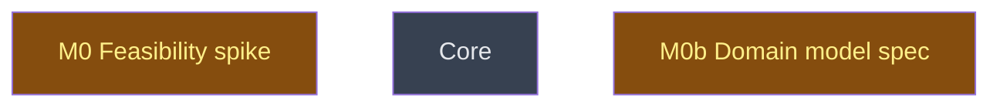

# rdm rework — meta-roadmap

## Context
The milestone graph for implementing `__design__/rdm/architecture.md`: the `managing-roadmaps` tooling moves from the `dirtree-rdm` script to a Rust core (`rdm-engine`) with an MCP server (`rdm-mcp`) and a CLI (`rdm-cli`). Each node is one milestone. Its detailed roadmap is not here: the milestone's own session, started by Eliott in plan mode with the milestone's reminder (list "Agent Skills") and a link to its leaf, writes it as a separate campaign `__roadmap__/<milestone>/`.

## Reference Documents
- [R01 Architecture](../../__design__/rdm/architecture.md) — the design every milestone implements; updated together with the code when a decision changes
- [R02 Plugin binaries observation](../../__reports__/dirtree_rdm_plugin_binaries/00-observation_v0.md) — the darwin-only binaries problem the new distribution removes, input to M7
- [R03 Creation-time bugs audit](../../__reports__/managing_roadmaps_audit/00-creation_time_bugs_v0.md) — defects of the current tool and skill text, input to M2 and M8
- [R04 Domain model review](../../__reports__/rdm_domain_model_review/01-gap_analysis_v0.md) — why M0b exists, what it owns and which leaves amendment A1 edited

## Goal
`managing-roadmaps` ships as a plugin whose tools are a published Rust MCP server and CLI over one core, with JSON roadmaps, full CRUD under an amendment log, and a graph view.

## Pre-conditions
- [x] Design approved by Eliott and written as `__design__/rdm/architecture.md` (2026-11-11)
- [x] MCP Apps rendering from a local server confirmed in the desktop app by Eliott (2026-11-11)

## Success Gates
- ⬜ Every milestone leaf below is `done`
- ⬜ `rdm-schema`, `rdm-engine`, `rdm-mcp` and `rdm-cli` are published and the `managing-roadmaps` plugin pins the server it starts
- ⬜ `__design__/rdm/architecture.md` describes what is built, with no decision left marked provisional unless deliberately carried on

## Gotchas
- Depth is ordering, so the tree over-sequences one edge: M6 needs only M4 but also waits on M5. The reminders' `after:` fields keep the exact edges; a milestone may start early on them if Eliott says so.
- The consumer rule: `rdm-mcp` and `rdm-cli` hold no roadmap logic. M1 to M3 complete the core before either consumer starts, which is why M4 and M5 can run in parallel.
- Ownership of shared pieces: M0 owns the workspace skeleton and the pinned `rmcp`; M0b owns the schemas, the read model and the status meanings; M1 owns the error type and id minting; M2 owns amendments and diagnostic codes; M4 owns the tool list (R01's table is a suggestion); M6 owns the app-only tool and the built HTML; M7 owns every release and manifest file; M8 owns the skill text and the removal of `dirtree-rdm`.
- Each milestone leaf has the same three steps: plan (its campaign, approved by Eliott), build and land (on `feat/<milestone>`, one merge commit on `main`), close out (knowledge-transfer report, this leaf marked `done`, reminder reconciliation proposed). The milestone's own plan decides how the work inside it is run.
- Until M8 lands, roadmaps are authored with `bash skills/managing-roadmaps/scripts/dirtree-rdm.sh` from the repository root; leaf paths passed to `add` need the `.md` suffix. From M8 on, with `rdm`.
- Environment: Rust with local `cargo` (1.99; MSRV 1.88 from `rmcp`); Node pinned by the M6 plan for the view; Python tooling through `uv`. This machine is shared: one `CARGO_TARGET_DIR` for all agents of a milestone, removed when the milestone lands.
- Git management follows the `writing-history` skill, and anything reaching `main` follows `writing-release`. Nothing is pushed until Eliott says so. Publishing to crates.io is Eliott's call.
- Reminder notes are append-only: changes go through the scheduling-work skill's writer, and only on Eliott's yes.
- A change that invalidates `__design__/rdm/architecture.md`, CONTRIBUTING or the README updates it in the same merge.

## Status

## Nodes
| Node | Type | Status |
|:-----|:-----|:-------|
| `m0_feasibility_spike.md` | 📄 Leaf Task | 🔄 In Progress |
| `core/` | 📁 Directory | ⬜ Planned |
| `m0b_domain_model_spec.md` | 📄 Leaf Task | 🔄 In Progress |

## Amendment Log
| ID | Date | Source | Nodes Added | Rationale |
|:---|:-----|:-------|:------------|:----------|
| A1 | 2026-11-16 | __reports__/rdm_domain_model_review/01-gap_analysis_v0.md | [ "m0b_domain_model_spec.md" ] | No milestone owned the domain model; also edits the planned leaves m0, m1, m2, m4, m6, m7 and this README, and Eliott chose to keep the label M0b |

## Progress
| Node | Branch | Commits | Notes |
|:-----|:-------|:--------|:------|
