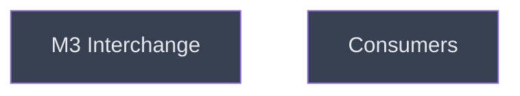

# Interchange

## Context
Depth 3. Runs after M2. M3 completes the core with markdown export and the legacy importer, so that both consumers start on a finished library.

## Goal
A roadmap can leave the store as markdown and a legacy markdown roadmap can enter it.

## Pre-conditions
- [ ] `m2_graph_engine.md` is `done`

## Success Gates
- ⬜ `m3_interchange.md` is `done`

## Status

## Nodes
| Node | Type | Status |
|:-----|:-----|:-------|
| `m3_interchange.md` | 📄 Leaf Task | ⬜ Planned |
| `consumers/` | 📁 Directory | ⬜ Planned |

## Amendment Log
| ID | Date | Source | Nodes Added | Rationale |
|:---|:-----|:-------|:------------|:----------|

## Progress
| Node | Branch | Commits | Notes |
|:-----|:-------|:--------|:------|
