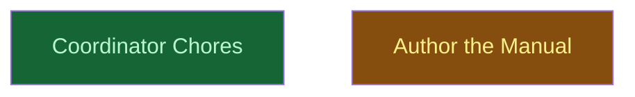

# writing-release-rework

## Context
Rewrites `skills/writing-release` from a Hatch-era writer of PR bodies and Discord posts into the Org's release-cycle manual. The manual covers integration lanes into `main`, PRs that become merge commits, releases cut by CI as a consequence of merging, release tooling chosen from what a repo contains, a single channel by default, and recovery. It ships as `writing-release@2.0.0`. It depends on the survey in R01 and hands commit vocabulary and branch-to-parent integration to `writing-history`. It is consumed by every future agent that lands work on `main` or sets up releases in any repo.

## Reference Documents
- [R01 Architecture analysis](../../__reports__/writing-release-rework/00-architecture_analysis_v0.md) — the cross-repo survey, Candler as one data point, and the risk register; SOURCE MATERIAL ONLY, never quoted or named in shipped files
- [R02 Current skill](../../skills/writing-release/SKILL.md) — the dispatcher being replaced; its four `references/` are the source for `pull-requests.md` and are deleted in `author/process.md` step 3
- [R03 writing-history dispatcher](../../skills/writing-history/SKILL.md) — the sister skill this one composes with; its shape (Primary Directive + Navigation) is the model for the new SKILL.md
- [R04 writing-history branches](../../skills/writing-history/references/branches.md) — the branch-to-parent integration contract that the direct lane reuses and must not be restated
- [R05 writing-history convention setup](../../skills/writing-history/references/convention-setup.md) — its "Recommending a Stack" release-tool rows move to `setting-up.md`
- [R06 Release factory](../../release-config.js) — how this repo releases each skill (semantic-release per skill, `chore(release)` bump commit)

## Goal
Ship `writing-release@2.0.0` as a stand-alone, best-practice-compliant release-cycle manual, and hand off cleanly from `writing-history`.

## Pre-conditions
- [x] R01 is committed on the integration branch `claude/writing-release-rework-bff076`
- [x] `skills/writing-release/` 1.0.0 exists, with its four Hatch references as generalisation sources
- [x] `uv` is available for `tools/*.py`, and `python3` for the one-liner checks

## Success Gates
- ✅ `skills/writing-release/` holds `SKILL.md` plus exactly the six references named in the contract below, and none of the four Hatch files
- ✅ `uv run tools/package_skill.py skills/writing-release dist/` emits `dist/writing-release.skill`, and `uv run tools/check_plugin.py --root . --spec plugin.spec.json` passes
- ✅ After `uv run tools/assemble_plugin.py writing-release`, `git status --porcelain plugins/` prints nothing
- ✅ The residue check (R01 repo names, Discord, meta-discourse markers, absolute "every change goes through a PR" wording) is empty over the shipped files
- ✅ Over `main..HEAD`, exactly one commit touching `skills/writing-release/` carries `BREAKING CHANGE:`, at least one `feat(writing-history)` commit touches `skills/writing-history/`, and no release-type commit touches `skills/managing-roadmaps/` or `skills/writing-reports/`
- ✅ All five evals in `skills/writing-release/evals/evals.json` pass, and `__reports__/writing-release-rework/01-verification_v0.md` records V1, V2 and both content-pass tables

## Gotchas
### CONTRACT — every brief carries this section verbatim
**C1 Files and required H2 headings** (`skills/writing-release/`; any file over ~100 lines also opens with `## Contents`):
- `SKILL.md` — frontmatter `name: writing-release` + a third-person `description` (≤1024 chars, says what + when); body `# Writing Release`, `## Primary Directives`, `## Navigation`; ≤500 lines
- `references/lifecycle.md` — `## Integration Lanes`, `## Choosing a Lane`, `## Mapping Lanes in a Repository`, `## The Lifecycle`, `## Invariants`, `## Where Each Piece Lives`
- `references/pull-requests.md` — `## Opening a Pull Request`, `## Title`, `## Body`, `## Landing`, `## Self-Merge and Its Fallback`, `## After the Merge`
- `references/setting-up.md` — `## Capabilities a Release Pipeline Needs`, `## Choosing Tooling from Contents`, `## Repository Settings`, `## The CONTRIBUTING Section`, `## Adoption Checklist`
- `references/ci-release-job.md` — `## Triggers and Concurrency`, `## Job Graph`, `## Permissions, Tokens, and Branch Protection`, `## The Bump Commit`, `## Hardening`, `## Monorepos`, `## Idempotent Re-runs`
- `references/channels.md` — `## One Channel by Default`, `## When to Add a Channel`, `## The Lagged Release-Candidate Pattern`, `## Prereleases per Tool`, `## The Cost of a Long-Lived Development Branch`
- `references/recovery.md` — `## Nothing Was Released`, `## The Bump Push Was Rejected`, `## First Release and Missing Tags`, `## Re-running a Release`, `## History Rewritten on main`, `## Local main Is Stale`, `## First Run of a New Release Job`
- Each reference is ≤350 lines. References are one level deep: SKILL.md links to each reference, and references link to each other only by relative links (`other.md` plus an optional `#anchor`).
**C2 Owner table** — each fact is stated once, in its owner, and linked from everywhere else:
| Fact | Owner |
|:--|:--|
| Lane table, decision procedure, why a wrong lane is safe, mapping lanes in CONTRIBUTING | `lifecycle.md` |
| Invariants: rebase before merge, merge-commit only, PR title = merge subject, PR body = merge body, pull `main` after merge, release only from CI | `lifecycle.md` §Invariants |
| Writing the title and body, `gh` mechanics, self-merge fallback | `pull-requests.md` |
| Capability checklist, tooling-by-contents matrix, repo settings, CONTRIBUTING template | `setting-up.md` |
| Triggers, concurrency, job graph, permissions, `GITHUB_TOKEN` vs GitHub App token, branch protection vs the direct lane, `[skip ci]`, exact action pins, runner git identity, path filters, drift checks, idempotency | `ci-release-job.md` |
| Single-channel default, adoption triggers, lagged-rc pattern, per-tool prereleases | `channels.md` |
| Failure modes and their fixes | `recovery.md` |
| Commit vocabulary and messages, version-bump semantics, branch-to-parent integration, worktrees | the `writing-history` skill — referenced by skill name and file name (e.g. "`writing-history` → `references/branches.md`"), never a relative path across skills, never restated |
**C3 Lanes — pinned verbatim; the wording may be tightened later only by the content passes, and the thresholds never:**
- Adjudicated 2026-10-29 after V2 (findings F02, F04, F05, F06, F12; recorded in `__reports__/writing-release-rework/01-verification_v0.md`): closes the gap where a non-release-type change to a released path fell to Direct, defines when Self-merge collapses to Reviewed, and fixes the Direct order. Intent and the Reviewed-PR conditions are unchanged.
| Lane | When | How | Maintainer approval |
|:--|:--|:--|:--|
| Reviewed PR | Lands a roadmap campaign or a multi-leaf feature branch; carries a `BREAKING CHANGE`; changes CI, release machinery or repository settings; changes a persisted contract (schemas, public interfaces others pin); or the agent is uncertain | Topic branch → PR → CI green → maintainer approves → merge commit | Yes |
| Self-merge PR | Ships something — a release-type commit, or any change under a released path — and is self-contained: one unit, no machinery, no persisted contract, undone by one revert (a fix, a refactor, a small feature in one unit, a dependency bump). Requires gating CI and a host that lets the agent merge without an approving review; otherwise it is a Reviewed PR | Topic branch → PR → CI green → the agent rebases, merges with a merge commit, reports the link. If anything refuses the merge (the harness, a permission classifier, or the host's branch policy), the agent does not retry or work around it: it hands the green PR to the maintainer and says why | No (a refused self-merge falls back to the maintainer) |
| Direct | Releases nothing, touches no released path, and changes nothing about how the repo builds, verifies or releases: reports, roadmap nodes and status, docs outside released units, typo or link fixes outside released paths, regenerated artifacts outside released paths | `git pull --ff-only` → `writing-history` branch-to-parent integration if branched → push to `main`. If `main` refuses the push, open a PR instead; never bypass or `--admin` unless CONTRIBUTING names this change class as Direct with a bypass | No |
- Decision procedure, first match wins: (1) any Reviewed-PR condition → Reviewed PR; (2) otherwise, would merging release something or change a released path → Self-merge PR (or Reviewed PR when its requirements are not met); (3) otherwise → Direct. Where the release tool does not scope releases by path, every shipped path is a released path, and a release-type commit releases wherever it lands.
- A wrong lane is cheap: CI still releases a direct push that turns out to be release-type, and the commit-range check still runs on every push to `main`.
- Each repo states its own lanes in a CONTRIBUTING "Integration lanes" table (released paths, release-type commits), derived from its release config with `writing-history`'s precedence: machinery → docs → interview.
- The direct lane needs `main` unprotected, or protected with a bypass for maintainers and the release bot (`ci-release-job.md` owns that tradeoff).
**C4 Defaults the manual argues for:** one release channel (`main`); releases cut only by CI after a merge, with no release PRs and no local release commands; tooling derived from what the repo contains, preferring the main language's toolchain (not critical, since sustainability and leanness win); a CI bump commit `chore(release): … [skip ci]`, a tag and a GitHub Release; registry publishing decided per repo.
**C5 Stand-alone rule:** shipped files describe usage patterns only. No individual repo, project, person, PR number or campaign; no history of this refactor; no meta-discourse ("as decided", "previously", "this rework", "the old templates"); no advice overfitted to one data point. R01 is source material, never quoted or named. Use generic placeholders (`<scope>`, `<unit>@<version>`, "a Rust workspace", "a skill monorepo"). Avoid time-sensitive statements; a tool version is allowed only as an example of exact pinning.
**C6 Commit hygiene (implementers):**
- commit with `git commit --no-verify -F <file>`;
- never stage `plugins/` or `dist/`; never touch `skills/*/CHANGELOG.md` or `skills/*/package.json` (bot-managed);
- scope is `writing-release` (or `writing-history` / `reports` / `roadmap` where stated);
- only `author/process.md` step 3 carries a `BREAKING CHANGE:` footer;
- end every message with `Co-Authored-By: Claude Sonnet 5 <noreply@anthropic.com>`.
**C7 Report defects, don't implement them:** if a leaf's spec, the contract or a fact here is wrong, stop and report it with evidence instead of writing content built on it.
### Mechanics
- Generated-file conflicts are avoided, not resolved. `core.hooksPath` is shared by all worktrees, so `.githooks/pre-commit` would rebuild and stage `plugins/writing-release/` on every implementer commit. Hence C6 `--no-verify`: implementers run `uv run tools/package_skill.py skills/writing-release dist/` by hand as their final check, and only the coordinator's commits fire the hook.
- `git merge --no-ff` does not fire `pre-commit`, so the close (`author/refine/standalone/review/README.md`) regenerates `plugins/` with an explicit coordinator commit. A changed `plugin.spec.json` also needs `uv run tools/spawn_plugin.py spawn --force`, because `assemble_plugin.py` copies only the skills subtree.
- Cross-skill links: plugins install skills separately, so a relative link from `writing-release` into `writing-history` would break once installed. Name the skill and the file instead (C2).
- Verification by risk: V1 (facts) reviews `author/tooling.md` and `author/ci_and_recovery.md` before they merge; V2 (`review_and_evals.md`) reviews the whole skill after both content passes. `process.md` and the content passes merge on their reports plus the coordinator's integration review.
- Landing on `main` is itself a Reviewed-PR-lane change (a campaign landing), opened only on the maintainer's go-ahead.

## Status

## Nodes
| Node | Type | Status |
|:-----|:-----|:-------|
| `chores.md` | 📄 Leaf Task | ✅ Done |
| `author/` | 📁 Directory | 🔄 In Progress |

## Amendment Log
| ID | Date | Source | Nodes Added | Rationale |
|:---|:-----|:-------|:------------|:----------|

## Progress
| Node | Branch | Commits | Notes |
|:-----|:-------|:--------|:------|
