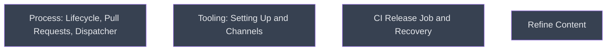

# Author the Manual

## Context
Level 1 of the campaign: three parallel author leaves write the six references and the dispatcher against the contract in the campaign README. Then `refine/` polishes the result. The leaves share no files: `process` owns lifecycle, pull requests and SKILL.md; `tooling` owns setting-up and channels; `ci_and_recovery` owns the CI release job and recovery.

## Goal
Produce a complete, contract-conformant `skills/writing-release/` from three parallel branches.

## Pre-conditions
- [ ] The campaign README contract (C1–C7) and the evals are committed on the integration branch
- [ ] Each implementer has its own worktree branched from the integration branch tip

## Success Gates
- ✅ All three leaves are merged with `--no-ff` after rebasing onto the integration tip
- ✅ V1 has reviewed `tooling` and `ci_and_recovery` before merge, and its findings are resolved
- ✅ Coordinator integration review: every relative link across the six references and SKILL.md resolves, every C2 fact is stated only in its owner, and the C3 lane wording is identical wherever it appears

## Gotchas
- `process` step 3's Navigation links to sibling-owned files and resolves only after all three merge; check the links at integration, not per branch.
- Implementers commit with `--no-verify` and never stage `plugins/` (C6), so the three branches cannot conflict there.

## Status

## Nodes
| Node | Type | Status |
|:-----|:-----|:-------|
| `process.md` | 📄 Leaf Task | ⬜ Planned |
| `tooling.md` | 📄 Leaf Task | ⬜ Planned |
| `ci_and_recovery.md` | 📄 Leaf Task | ⬜ Planned |
| `refine/` | 📁 Directory | ⬜ Planned |

## Amendment Log
| ID | Date | Source | Nodes Added | Rationale |
|:---|:-----|:-------|:------------|:----------|

## Progress
| Node | Branch | Commits | Notes |
|:-----|:-------|:--------|:------|
