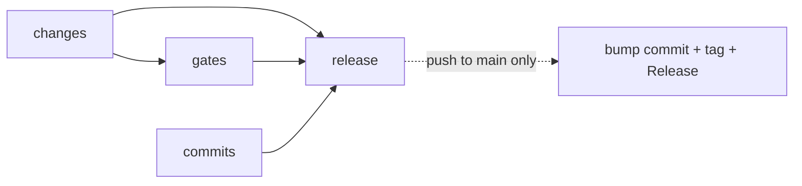

# CI Release Job

Tool-agnostic wiring for a CI that gates pull requests and pushes to `main`, then cuts the release only after the gates pass. The examples are GitHub Actions; the pattern (gates, commit checks, one release job that never gets cancelled) carries to other CI systems. Which release tool fills the `<release command>` placeholder is a tooling choice: [setting-up.md](setting-up.md#choosing-tooling-from-contents).

## Contents

- [Triggers and Concurrency](#triggers-and-concurrency)
- [Job Graph](#job-graph)
- [Permissions, Tokens, and Branch Protection](#permissions-tokens-and-branch-protection)
- [The Bump Commit](#the-bump-commit)
- [Hardening](#hardening)
- [Monorepos](#monorepos)
- [Idempotent Re-runs](#idempotent-re-runs)

## Triggers and Concurrency

| Trigger | Why |
|:--|:--|
| `pull_request` with `types: [opened, synchronize, reopened, edited]` | The gates and the commit checks run on every PR. The default types omit `edited`, and the PR title becomes the merge commit subject ([lifecycle.md](lifecycle.md#invariants)), so a title edit must re-run the title check. |
| `push` to `branches: [main]` | Runs after every landing, from any lane: the commit-range check, then the release. |
| `workflow_dispatch` | Starts a fresh run on the current tip of `main` for recovery ([Idempotent Re-runs](#idempotent-re-runs)). |

- **Topic-branch pushes alone run nothing.** The `push` trigger names only `main`, so the PR is the gate. Open the PR early to get feedback. A PR with a merge conflict gets no `pull_request` run at all, so "no checks appeared" usually means "rebase".
- **`edited` also fires on body edits and base changes.** Skip the heavy gates for it (`github.event.action != 'edited'`, see [Job Graph](#job-graph)) so a typo fix in the body does not cost a full build.
- **Cancel superseded PR runs, never a run on `main`.** A cancelled release run can leave a tag without its Release, or a version without its tag. Group by workflow and ref, and make `cancel-in-progress` an expression:

  ```yaml
  concurrency:
    group: ${{ github.workflow }}-${{ github.ref }}
    cancel-in-progress: ${{ github.event_name == 'pull_request' }}
  ```

- **A queued run can be replaced.** Within a group, one run executes and at most one waits; a newer waiting run replaces an older waiting one. That is safe for the release (the tool releases everything since the last tag), but the replaced push's commit-range check never runs. PR-time checks already covered every PR commit, so the gap is Direct-lane pushes; keep those few and small.
- **Do not put path filters on the workflow triggers.** A workflow skipped by `paths`, `paths-ignore` or a skip marker leaves its checks "Pending", which blocks any PR that requires them, and the commit-range check must run on every push to `main` whatever it touched. Filter at job level instead: a `changes` job decides which gates are worth running, and a job skipped by `if` reports success.

## Job Graph



| Job | Runs on | Does |
|:--|:--|:--|
| `changes` | every event | Lists files changed in the PR or push; outputs whether anything outside the non-released paths (reports, roadmaps, docs outside released units) changed. A manual run has no base, so it outputs `true`. |
| `gates` | PR and push, when `changes` says so | Lint, tests, build, drift checks ([Monorepos](#monorepos)). Whatever the repo already verifies. |
| `commits` | every event | Commit-message check over the range (PR: base..head; push: before..after), plus the PR-title check on PRs. Needs a git identity ([Hardening](#hardening)). |
| `release` | push or dispatch on `main`, after the others | Cuts the release. Never filtered by path: a direct push that turns out to be release-type must still release. |

```yaml
name: ci
on:
  pull_request:
    types: [opened, synchronize, reopened, edited]
  push:
    branches: [main]
  workflow_dispatch:

permissions:
  contents: read

concurrency:
  group: ${{ github.workflow }}-${{ github.ref }}
  cancel-in-progress: ${{ github.event_name == 'pull_request' }}

jobs:
  changes:
    runs-on: <runner>
    outputs:
      gated: ${{ steps.diff.outputs.gated }}
    steps:
      - uses: actions/checkout@<full-sha> # <tag>
        with:
          fetch-depth: 0
      - id: diff
        env:
          BASE: ${{ github.event.pull_request.base.sha || github.event.before }}
          HEAD: ${{ github.event.pull_request.head.sha || github.sha }}
        run: <list files in $BASE...$HEAD; write gated=true unless all match a non-released path; gated=true when BASE is empty>

  gates:
    needs: changes
    if: needs.changes.outputs.gated == 'true' && github.event.action != 'edited'
    runs-on: <runner>
    steps:
      - uses: actions/checkout@<full-sha> # <tag>
      - run: <lint, test, build, drift check>

  commits:
    runs-on: <runner>
    steps:
      - uses: actions/checkout@<full-sha> # <tag>
        with:
          fetch-depth: 0
      - run: |
          git config user.name  "<bot name>"
          git config user.email "<bot email>"
      - if: github.event_name == 'pull_request'
        env:
          TITLE: ${{ github.event.pull_request.title }}
        run: |
          <check "$TITLE">
          <check commits ${{ github.event.pull_request.base.sha }}..${{ github.event.pull_request.head.sha }}>
      - if: github.event_name == 'push'
        run: <check commits ${{ github.event.before }}..${{ github.sha }}>

  release:
    needs: [changes, gates, commits]
    if: >-
      always()
      && github.ref == 'refs/heads/main'
      && github.event_name != 'pull_request'
      && needs.changes.result == 'success'
      && needs.commits.result == 'success'
      && contains(fromJSON('["success","skipped"]'), needs.gates.result)
    runs-on: <runner>
    permissions:
      contents: write
    steps:
      - id: app            # only when main is protected: see the next section
        uses: actions/create-github-app-token@<full-sha> # <tag>
        with: <app credentials from a variable and a secret>
      - uses: actions/checkout@<full-sha> # <tag>
        with:
          fetch-depth: 0
          token: ${{ steps.app.outputs.token || github.token }}
      - run: |
          git config user.name  "<bot name>"
          git config user.email "<bot email>"
      - run: <install the release tool at pinned versions>
      - env:
          <TOKEN_VARIABLE_THE_TOOL_READS>: ${{ steps.app.outputs.token || github.token }}
        run: <release command>
```

Why the `release` condition is spelled out:

- A job whose `needs` entry failed or was skipped is skipped itself unless its `if` says otherwise, hence `always()`.
- `always()` also runs the job after a failure, so the condition re-states every requirement. `gates` may be skipped (nothing gated changed) but not failed; `changes` and `commits` must have succeeded.
- `fetch-depth: 0` matters: the checkout fetches one commit by default, and range checks and tag-based release tools need history and tags.
- `contents: read` at workflow level and `contents: write` on the release job alone keeps the write token out of every other job.

## Permissions, Tokens, and Branch Protection

Two documented behaviours decide this section:

1. **`GITHUB_TOKEN` events start no new run.** A push, tag, Release or label made with it creates no workflow run, except `workflow_dispatch` and `repository_dispatch`. (A PR opened or updated with it does start `pull_request` runs, but held for approval.) This prevents recursive runs.
2. **A GitHub App installation token's events do start runs.** That is also why the [bump commit](#the-bump-commit) needs `[skip ci]` once an app token pushes it.

Setting `permissions:` is a whitelist: once any key is set, every unlisted permission is `none`. List what the tool needs (`contents: write` for the bump commit, tag and Release; add `issues: write` and `pull-requests: write` only if the tool comments on them). An explicit block also makes the workflow independent of the repository's default token permissions.

### Choosing the token

| Situation | Token | Notes |
|:--|:--|:--|
| `main` unprotected; nothing downstream reacts to tags or Releases | `GITHUB_TOKEN` with job-level `contents: write` | No secret to manage; the bump push cannot loop. |
| `main` protected, with a bypass for the release bot | GitHub App token, app on the bypass list | Minted inside the release job (the token is revoked when the job ends, so it cannot be handed to another job). Limit it with the action's per-permission inputs; by default it inherits every permission of the installation. |
| Downstream workflows must react to tags or Releases | App token, or an explicit `workflow_dispatch` from the release job | `GITHUB_TOKEN` events trigger nothing downstream. Doing the downstream work inside the release job avoids the problem. |

Use the same token for the checkout and for the release tool, so the bump push and the Release API call act as one identity. A tool that authenticates through its own token variable may need `persist-credentials: false` on the checkout so the default token does not win; check the tool's documentation. A personal access token is the fallback of last resort: it belongs to a person, and a classic one reaches every repository that person can.

### Protection versus the lanes

Both the bump push and the Direct lane push to `main` without a PR. Protection that requires PRs or status checks refuses them unless the pusher may bypass. Required status checks apply to direct pushes too: the commit must already have passed them, and a fresh commit has no completed checks (a `[skip ci]` commit never gets any).

| `main` is | Direct lane | Bump push | Tradeoff |
|:--|:--|:--|:--|
| Unprotected | Works | Works with `GITHUB_TOKEN` | Leanest. The lanes are convention; CI is the backstop (the commit-range check and gates run after the landing, and CI still releases a direct push that turns out to be release-type). |
| Protected, with a bypass list holding maintainers and the release app, bypass mode "always" | Works for maintainers | Works with the app token | Server-side enforcement of PR requirements, at the price of one app to create, install and keep. |
| Protected, no bypass | Impossible | Rejected | Only workable with tooling that pushes nothing to `main`. Choose it deliberately: [setting-up.md](setting-up.md#choosing-tooling-from-contents). |

What the documentation says about bypassing:

- **Rulesets:** bypass actors can be roles (repository admin, maintain or write), teams and GitHub Apps. "Always" allows direct pushes. "For pull requests only" lets the actor bypass only through a PR, which serves neither the bump push nor the Direct lane.
- **Branch protection rules:** restrictions do not apply to repository admins unless "Do not allow bypassing" (include administrators) is on, so turning that on removes the admin's Direct lane. Actors can be added to bypass lists only in organization-owned repositories. "Restrict who can push" does not waive required checks or required PRs.
- **Rulesets and branch protection rules stack**, and the most restrictive result applies: a forgotten classic rule can still block a ruleset's bypass.
- **`GITHUB_TOKEN` and protection:** the built-in token acts as a write-access identity, and the bypass-list documentation names roles, teams and GitHub Apps. Plan on an installed app, not on the built-in token being admitted, whenever `main` is protected.
- **Force pushes** are blocked on protected branches by default; a ruleset's non-fast-forward rule blocks them without any other restriction. Even a repo that keeps `main` open should block them ([recovery.md](recovery.md#history-rewritten-on-main)).
- **Required checks and skips:** a PR whose head commit carries a skip marker cannot merge while checks are required, so never put one in a topic commit or a PR body (the body becomes the merge commit message).
- **Merge settings** (merge commits only, linear history off) belong to [setting-up.md](setting-up.md#repository-settings): "Require linear history" forbids the merge commits this manual depends on.

Secrets: the app key is read only by the release job, which never runs on PR events, so PR runs never see it. PRs from forks get a read-only token and no secrets regardless, so gates must not need either.

## The Bump Commit

The release job commits `chore(release): … [skip ci]` to `main`, then tags it and creates the Release (the order is the tool's).

- **What it changes:** the version fields of each released unit, lock files that embed them, and the changelog. These are bot-managed; people do not edit them by hand, which also keeps merge conflicts in them rare.
- **Why `[skip ci]`:** a push-triggered run on the bump commit would only find nothing to release, and with an app token it would run on every release. The marker (`[skip ci]`, `[ci skip]`, `[no ci]`, `[skip actions]`, `[actions skip]`, or a `skip-checks: true` trailer) skips the `push` and `pull_request` runs that commit would start, and nothing else: it does not stop `workflow_dispatch`, `pull_request_target`, or runs started by other commits. Keep it even under `GITHUB_TOKEN`, where it is redundant, so a later switch to an app token cannot start a loop.
- **Who sees it:** the next push's `before` is the bump commit, so the next range check does not re-check it. It is checked by whatever walks history from the last tag, so its message must pass the same commit checker: `chore` is a non-release type, which is also what stops it releasing itself. Make sure the checker's vocabulary allows the `release` scope (vocabulary: `writing-history` → `references/commit-authoring.md`).
- **Where it lands:** after the merge, a minute or more later. Anyone who branches from a stale `main` misses it: [recovery.md](recovery.md#local-main-is-stale).
- **A skip marker is per commit.** It does not carry over to later commits, and it must never reach a topic commit or a PR body. Documentation does not say how a marker interacts with a tag push of that commit, so do not rely on a tag-triggered workflow for releases the bot tags; publish from the release job.

## Hardening

| Rule | Why |
|:--|:--|
| Pin every action to a full commit SHA, with the tag as a trailing comment (`uses: <owner>/<action>@<full-sha> # v<x.y.z>`), and pin the release tool and its plugins through a lock file or exact versions | A tag or a floating major tag (`@v4`) can be moved or deleted, so a broken or compromised release of an action reaches you on the next run. A SHA cannot move. Verify the SHA belongs to the action's repository, not a fork. Let a dependency-update bot raise the pins. |
| Give the runner a git `user.name` **and** `user.email` before any tool that reads them | Commit-message verifiers that create temporary commits and release tools that commit or tag fail without an identity, and a runner does not come with one you can assume. Do it in every job that runs such a tool, not only the release job. |
| Never cancel on `main` | See [Triggers and Concurrency](#triggers-and-concurrency). |
| Pass untrusted values through `env`, never into the script text | `${{ github.event.pull_request.title }}` inside `run:` is a script-injection vector; an intermediate environment variable is not. |
| Avoid `pull_request_target` for gates | It runs in the base repository's context with a write token and secrets; running PR code there is the classic compromise. |
| Release only from `main` | The job's `if` names the ref. A manual dispatch from another branch must not release. |
| Keep write access scoped to the release job | Top-level `permissions: contents: read`; see [Permissions, Tokens, and Branch Protection](#permissions-tokens-and-branch-protection). |
| Do all publishing inside the release job | Downstream triggers on tags or Releases are unreliable under `GITHUB_TOKEN`, and one job keeps the effects ordered. |

## Monorepos

A repo with several units (packages, skills, crates) that release independently keeps one workflow and one release job. The tool works out which units have release-type commits.

- **Per-unit path filters** only choose which gates and builds run. Compare against the unit's last tag, not `before..after`: a skipped or failed earlier run would otherwise lose that unit's changes forever. The last tag of a unit is `git tag --list '<unit>@*' --sort=-version:refname | head -1`, falling back to the first commit when there is none.
- **Per-unit tag lines** `<unit>@<version>` keep units independent. The `@` delimiter keeps one unit's name from matching another's prefix. A tool must be configured with the same tag format for every unit, or it will not find the baseline ([recovery.md](recovery.md#first-release-and-missing-tags)).
- **Build once, then release.** Per-unit or per-platform builds run in their own jobs and hand artifacts to the release job as workflow artifacts. The release job must not rebuild with different inputs.
- **Drift jobs** regenerate committed generated files (assembled plugin trees, schema outputs, lock files) and fail on a diff:

  ```yaml
  - run: <regenerate every generated tree>
  - run: |
      if [ -n "$(git status --porcelain <generated paths>)" ]; then
        echo "::error::Generated files are out of sync; regenerate and commit them."
        git status --porcelain <generated paths>
        exit 1
      fi
  ```

  Use `git status --porcelain`, not `git diff`: it also reports files the regeneration created. Make the drift job a gate, so a stale generated tree blocks the PR instead of surfacing at release time. Generated files that the bump commit rewrites (versions) are excluded from the check or regenerated by the release tool, never by hand.

## Idempotent Re-runs

The aim is that running the release again, or a lost race, costs nothing and needs no clean-up.

- **State comes from tags, not from the run.** A tool that derives "unreleased" from the last tag (or from a version with no tag) does the same thing when run twice: the second run finds nothing new, or the same commits again. Check that your tool's steps are conditional in this way before relying on re-runs.
- **A lost push race is recovered by the next run.** If another push lands while the release job works, the bump push is rejected as non-fast-forward. When that happens before any tag or Release exists, nothing was published, and the next run releases the accumulated commits together. Otherwise verify and clean up: [recovery.md](recovery.md#the-bump-push-was-rejected).
- **A re-run reuses the original commit and ref.** The GitHub "re-run" button (and `gh run rerun`) runs against the SHA of the first attempt, so if `main` has moved it works from stale history and the bump push is rejected. Re-run a failed job only for transient failures with `main` unmoved; otherwise start a fresh run with `workflow_dispatch` on `main`. Re-runs also act with the privileges of the original actor.
- **Concurrency serialises runs.** A dispatch and a push on `main` share a group, so a manual run cannot overlap a release in flight.
- **Order of effects decides what a half-failure leaves.** A run that fails before pushing leaves nothing to undo. A run that pushed the bump commit but failed before the tag or Release leaves a state the next run may or may not complete, depending on the tool. Learn which on the first release ([recovery.md](recovery.md#first-run-of-a-new-release-job)) rather than during an incident.
