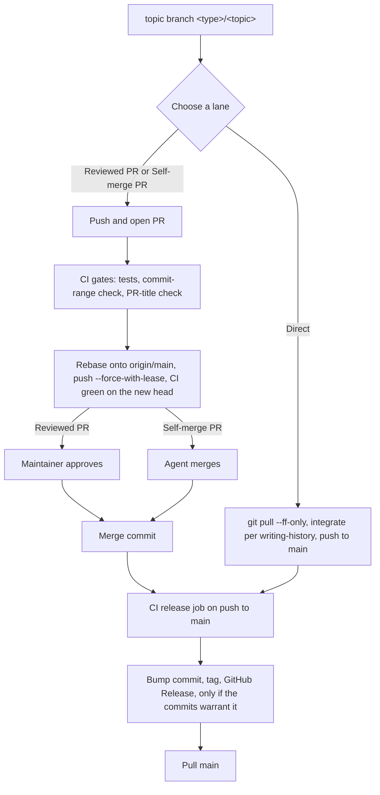

# Integration Lifecycle

How a change travels from a topic branch to `main`, and how a release follows from it. This file owns the lane table, the decision procedure and the invariants; the other references link here rather than restate them.

## Contents

- [Integration Lanes](#integration-lanes)
- [Choosing a Lane](#choosing-a-lane)
- [Mapping Lanes in a Repository](#mapping-lanes-in-a-repository)
- [The Lifecycle](#the-lifecycle)
- [Invariants](#invariants)
- [Where Each Piece Lives](#where-each-piece-lives)

## Integration Lanes

Merging to `main` is what releases: the release job runs on every push to `main` and cuts a release when the new commits warrant one. So the line to draw is not "code versus docs" but **what the change would release**.

A pull request (PR) buys two things: CI runs on the change before it reaches `main`, and a maintainer gets a point to review. Both are worth their latency only when the change risks something. A change that ships nothing and cannot break how the repository builds, verifies or releases gains little from either, so it takes a lighter lane.

Terms the lanes rely on; the first two are defined per repository in [Mapping Lanes in a Repository](#mapping-lanes-in-a-repository):

- **Released path**: a path whose content ships in a release (source, packaged assets, a published unit's files). A change there is never Direct, even when its commit type releases nothing, because it ships in the next release.
- **Release-type commit**: a commit whose type the release config maps to a version bump.
- **Maintainer**: whoever approves Reviewed PRs and changes to release machinery or repository settings.
- **CONTRIBUTING**: the repository's contributing guide, whatever its file name.

| Lane | When | How | Maintainer approval |
|:--|:--|:--|:--|
| Reviewed PR | Lands a roadmap campaign or a multi-leaf feature branch; carries a `BREAKING CHANGE`; changes CI, release machinery or repository settings; changes a persisted contract (schemas, public interfaces others pin); or the agent is uncertain | Topic branch → PR → CI green → maintainer approves → merge commit | Yes |
| Self-merge PR | Ships something — a release-type commit, or any change under a released path — and is self-contained: one unit, no machinery, no persisted contract, undone by one revert (a fix, a refactor, a small feature in one unit, a dependency bump). Requires gating CI and a host that lets the agent merge without an approving review; otherwise it is a Reviewed PR | Topic branch → PR → CI green → the agent rebases, merges with a merge commit, reports the link. If anything refuses the merge (the harness, a permission classifier, or the host's branch policy), the agent does not retry or work around it: it hands the green PR to the maintainer and says why | No (a refused self-merge falls back to the maintainer) |
| Direct | Releases nothing, touches no released path, and changes nothing about how the repo builds, verifies or releases: reports, roadmap nodes and status, docs outside released units, typo or link fixes outside released paths, regenerated artifacts outside released paths | `git pull --ff-only` → `writing-history` branch-to-parent integration if branched → push to `main`. If `main` refuses the push, open a PR instead; never bypass or `--admin` unless CONTRIBUTING names this change class as Direct with a bypass | No |

A roadmap campaign or multi-leaf feature branch is a branch that integrates several sub-branches of one planned piece of work.

A Direct-lane push needs `main` unprotected, or protected with a bypass for maintainers and the release bot; [ci-release-job.md](ci-release-job.md#permissions-tokens-and-branch-protection) owns that tradeoff. Branch-to-parent integration for a branched Direct-lane change belongs to `writing-history` → `references/branches.md`, not to this manual.

## Choosing a Lane

First match wins:

1. Does any Reviewed-PR condition hold (campaign or multi-leaf landing, `BREAKING CHANGE`, CI, release machinery or settings, a persisted contract, or doubt)? Reviewed PR.
2. Otherwise, would merging release something or change a released path? Self-merge PR, or Reviewed PR when its requirements (gating CI, a host that lets the agent merge without an approving review) are not met.
3. Otherwise: Direct.

Where the release tool does not scope releases by path, every shipped path is a released path, and a release-type commit releases wherever it lands.

**Doubt is a Reviewed-PR condition.** When two lanes both seem plausible, take the heavier one.

**A wrong lane is cheap.** CI still releases a Direct-lane push that turns out to be release-type, and the commit-range check runs on every push to `main`, so a misjudged change is caught and released by the same machinery that handles every other one. The costs are asymmetric: an over-cautious lane costs only latency, an under-cautious one costs a release that only the gates vouched for. Hence the tie-break above. This holds for revertible releases. A published registry version cannot be republished, so on a publishing repository a lane mistake costs a version number.

**Why these thresholds.**

- In the Self-merge lane the gates stand in for review, which is why gating CI is a requirement and not a courtesy.
- Each Reviewed-PR condition names something hard to undo or something others depend on: a campaign landing is many changes at once, a breaking change or a persisted contract strands consumers, and changes to CI, release machinery or settings alter the gates themselves.
- "Self-contained" means one unit, no machinery, no persisted contract, and one revert undoes it. A change that fails any of these is not small, however few lines it touches.

For the PR lanes, [pull-requests.md](pull-requests.md) covers opening, titling, landing and the self-merge fallback.

## Mapping Lanes in a Repository

The lane table is generic; each repository states which paths and commits it means. Derive them with the precedence `writing-history` uses for commit vocabulary (`writing-history` → `references/commit-authoring.md`, "Deriving the Vocabulary"):

1. **Machinery is ground truth.** Read the release config and the CI release workflow:
   - the release tool's commit-analyzer or type-to-bump mapping gives the release-type commits;
   - per-unit manifests, package directories, the workflow's path filters and the tool's file globs give the released paths;
   - workflow files, the release config and settings-as-code are the machinery whose change forces a Reviewed PR;
   - a tool that does not scope releases by path (one version per run) makes every shipped path a released path; list them that way. In such a repository any release-type commit releases wherever it lands, so give changes to non-shipped files (reports, notes, docs outside the package) a commit type that releases nothing.
2. **Docs next.** Where there is no machinery, or it is silent, read CONTRIBUTING and the README for what ships.
3. **Interview last.** Ask the maintainer which paths ship, which commit types release, and which files are persisted contracts others pin. Write the answers down so the next agent derives them instead of asking again.

Record the result in CONTRIBUTING as an "Integration lanes" section ([setting-up.md](setting-up.md#the-contributing-section) covers the rest of that section). A repository whose host requires approvals, or which has no gating CI, records Self-merge as Reviewed PR in its table until a gate exists. Template:

```markdown
## Integration lanes

Released paths: `<path-glob>`, `<unit>/**`
Release-type commits: `<type>` (<bump>), `<type>` (<bump>), any `BREAKING CHANGE` footer (<bump>)

| Lane | This repository |
|:--|:--|
| Reviewed PR | Multi-part landings; `BREAKING CHANGE`; `<ci-workflow-path>`, `<release-config-path>`, repository settings; persisted contracts at `<schema-or-interface-path>`; doubt |
| Self-merge PR | A release-type commit, or any change under a released path, that is self-contained: one `<unit>`, no machinery, no persisted contract, undone by one revert. Needs gating CI and a host that lets the agent merge without an approving review; otherwise record this row as Reviewed PR |
| Direct | Releases nothing, touches no released path: `<non-shipped-dir>`, `<docs-dir>` outside released paths, typo and link fixes outside released paths, regenerated artifacts outside released paths. `git pull --ff-only`, integrate, push; if `main` refuses the push, open a PR instead |
```

Keep the template's wording in step with the table above; thresholds are not tuned per repository, only the paths and types they refer to. If CONTRIBUTING itself names a change class as Direct with a bypass, that is the one case where a bypass push is allowed.

## The Lifecycle



Copy this checklist and tick it off; the notes below it say where a failure sends you back.

```
- [ ] 1. Branch from an up-to-date main as <type>/<topic>; author commits per writing-history
- [ ] 2. Choose the lane (Choosing a Lane)
- [ ] 3. PR lanes: push and open the PR. Direct lane: git pull --ff-only, integrate per writing-history, push, then go to 7
- [ ] 4. CI gates pass on the PR: tests, commit-range check, PR-title check
- [ ] 5. Rebase onto origin/main and push --force-with-lease; CI green on the new head
- [ ] 6. Merge commit: after maintainer approval (Reviewed PR) or by the agent (Self-merge PR)
- [ ] 7. Release job runs on the push to main
- [ ] 8. Pull main; the release job may have added a bump commit
```

- **Step 3:** the PR steps are in [pull-requests.md](pull-requests.md#opening-a-pull-request). If a Direct-lane push is rejected because `main` moved, reset local `main` to `origin/main` (the topic branch still holds the work) and redo the integration; never `git pull --rebase` over the merge commit. If `main` refuses the push by policy, open a PR instead.
- **Step 4:** the PR-title check re-runs when the title is edited. A failing gate is fixed on the branch, then return to step 5.
- **Step 5:** rebase and push whenever `main` has moved. The head that merges must be the head CI went green on, so every new push returns you to step 4.
- **Step 7:** with no release-type commit in range the job finds nothing to release, which is correct ([recovery.md](recovery.md#nothing-was-released)). Triggers, job graph and permissions are in [ci-release-job.md](ci-release-job.md).

Releases happen on `main` only; adding a second channel is a deliberate decision with a cost ([channels.md](channels.md#one-channel-by-default)).

### Asked to "cut a release"

A release is a consequence of merging, so there is no command to run. First list what is unreleased: `git log <last-release-tag>..origin/main --format=%s`. Then:

- [ ] **(a) Release-type commits are on `main` but nothing was released:** the job missed or failed them. Go to [recovery.md](recovery.md#nothing-was-released) and [recovery.md](recovery.md#re-running-a-release).
- [ ] **(b) No release-type commit is pending:** there is nothing to release. Say so; do not tag by hand. A release follows once a release-type change lands through its lane.
- [ ] **(c) No release pipeline exists yet:** set one up, starting from [setting-up.md](setting-up.md#adoption-checklist).
- [ ] **(d) A specific version was requested:** forcing a version is a change to release config, which is machinery, so it goes through a Reviewed PR.

## Invariants

These hold in every lane that has the thing they govern. Each is here with its reason, so that an exception can be judged rather than guessed.

| Invariant | Why |
|:--|:--|
| Rebase before merge | CI's verdict then describes what `main` will contain, and the branch's commits read linearly under a single merge commit. Mechanics and rationale for branch-to-parent integration are in `writing-history` → `references/branches.md`. A branch that holds merge commits needs `git rebase --rebase-merges`, or the rebase flattens them. |
| Merge commit only; never squash, never rebase-merge | The release tool and the changelog read one commit at a time, so a squash replaces several commits (a `fix` and a `feat`, say) with one, and the bump and the changelog lose entries. A rebase-merge leaves no merge record, which is the one boundary that names the unit of work and lets it be reverted whole. |
| PR title = merge subject | The merge subject starts with the PR title (the host may append ` (#<n>)`, which the commit-range check must accept). The merge commit lands on `main` and is read by the same tooling as any commit, so its subject must satisfy the repository's commit vocabulary, and its type must release nothing of its own ([pull-requests.md](pull-requests.md#title)). CI checks the title for that reason. |
| PR body = merge body | The reasoning survives in `git log`, not only on a hosting page that can change or vanish. |
| Pull `main` after merge | The release job may have pushed a bump commit; a stale local `main` makes the next push fail or the next branch start behind ([recovery.md](recovery.md#local-main-is-stale)). |
| Release only from CI; no release PRs; no local release commands | One release ceremony is easier to sustain than several, and CI alone has the gates, the credentials and a clean checkout. A local release skips the gates, depends on one machine, and can race the job. The bump commit CI makes carries `[skip ci]` so it does not retrigger CI ([ci-release-job.md](ci-release-job.md#the-bump-commit)). |

The first four govern PR lanes; the Direct lane uses `writing-history`'s `--no-ff` integration in their place. The last two hold in every lane.

## Where Each Piece Lives

Each piece is a role; the file name varies by repository and tooling.

| Piece | Holds | Details |
|:--|:--|:--|
| CONTRIBUTING | The "Integration lanes" section, the PR conventions, the commit vocabulary pointer | [setting-up.md](setting-up.md#the-contributing-section) |
| CI workflow | Gates, commit-range check, PR-title check, the release job | [ci-release-job.md](ci-release-job.md) |
| Release config | Type-to-bump mapping, tag format, changelog, channels | [setting-up.md](setting-up.md#choosing-tooling-from-contents), [channels.md](channels.md) |
| Commit-check config | Allowed types and scopes, enforced by the commit-range and title checks | `writing-history` → `references/convention-setup.md` |
| Repository settings | Allowed merge methods, merge-message defaults, branch protection, branch deletion on merge | [setting-up.md](setting-up.md#repository-settings) |
| Version and changelog files | Written by the release job; contributors do not edit them | [ci-release-job.md](ci-release-job.md#the-bump-commit) |
